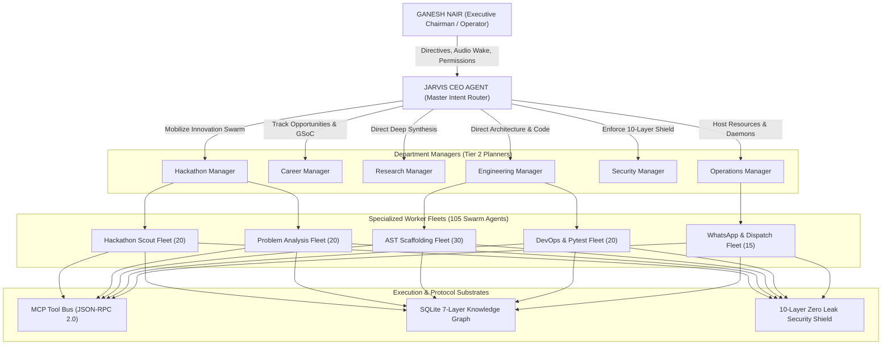

# Project JARVIS: Agent Organization Chart & Hierarchy

> **Governing Directive**: *"Rule 2: One Boss. Current problem: 100 repos, 100 powers, 100 agents. Who is in charge? Nobody. Solution: JarvisAgent (CEO). ONLY this agent can assign work, launch agents, approve tasks, and create projects. Every other agent reports upward."*

---

## 1. Executive Chain of Command

The JARVIS architecture mirrors a high-performance cognitive company where **Ganesh Nair** sits as the Executive Chairman and **JarvisAgent (CEO)** coordinates all operational departments:



---

## 2. Departmental Roster & Responsibilities

### Level 1: CEO Agent (`JarvisAgent`)
- **Single Point of Control**: Only the CEO agent accepts tasks from Ganesh, decomposes them into DAG task graphs (`task_graph.py`), assigns tasks to departments, and monitors SLA.
- **Fast Intent Routing**: <10ms triage between Macro Bypass, MCP Tools, GUI Visual Grounding, Voice Pipeline, and Frontier Cloud Reasoning.
- **Human-in-the-Loop Gateway**: Enforces cryptographic single-use approvals for destructive filesystem or credential access.

---

### Level 2: Department Managers

| Manager Agent | Department | Primary Objective | Key Deliverables |
| :--- | :--- | :--- | :--- |
| `hackathon_manager` | Hackathon & Innovation | Continuously hunt, rank, and scaffold hackathon submissions. | `PROBLEM_STATEMENT.md`, Architecture blueprints, working scaffolds. |
| `career_manager` | Career & Professional Growth | Accelerate Ganesh's career, internship acquisition, and GSoC readiness. | Daily job/internship digests, tailored ATS resumes, GitHub profile audits. |
| `research_manager` | Research & Intelligence | Deep multimodal synthesis of technical papers, GitHub trends, and documentation. | Verified research dossiers with verbatim citations and feasibility metrics. |
| `eng_manager` | Software Engineering & Systems | Production-grade code generation, refactoring, and test verification. | Python packages, FastAPI microservices, AST symbol graphs, >80% test coverage. |
| `security_manager` | Cybersecurity & Secret Protection | Absolute zero-leak credential isolation and cryptographic audit trails. | Presidio DLP redaction, AES-256-GCM vault, tamper-evident Merkle ledger. |
| `ops_manager` | Systems & Infrastructure | Edge GPU acceleration (RTX 4050), API rotator health, background schedulers. | VRAM management, Kokoro-TTS audio loops, Gemini/Groq key rotation. |

---

## 3. Worker Agent Fleets (The 105 Autonomous Swarm Agents)

To execute complex real-world workflows without latency degradation, workers operate in 5 coordinated divisions:

```
Total Active Fleet: 105 Micro-Agents
├── Reconnaissance Division (recon_01 .. recon_20)
│   ├── Target: Devfolio, Unstop, LinkedIn, Wellfound, GSoC Portal
│   └── Output: Structured JSON opportunities with prize and eligibility tags
├── Analysis Division (analysis_01 .. analysis_20)
│   ├── Target: Hackathon rulebooks, problem statements, rubric guidelines
│   └── Output: PROBLEM_STATEMENT.md with winning strategy synthesis
├── Scaffolding Division (scaffold_01 .. scaffold_30)
│   ├── Target: AST codebase mapping, boilerplate generation, environment setups
│   └── Output: Complete runnable project directories with requirements and configs
├── DevOps & Verification Division (devops_01 .. devops_20)
│   ├── Target: Pytest verification, CI/CD GitHub Actions authoring, linting
│   └── Output: .github/workflows/ci.yml, unit test suites, passing test logs
└── Communications Division (dispatch_01 .. dispatch_15)
    ├── Target: WhatsApp notification gateway, desktop alerts, system audio
    └── Output: Formatted WhatsApp digests sent directly to Ganesh (+919324094474)
```

---

## 4. Reporting & Escalation Protocols
1. **Upward Escalation Only**: No worker agent may bypass its department manager. Department managers report consolidated milestones to the CEO.
2. **Deterministic Task Gates**: A worker cannot mark a task `COMPLETED` on its own. It must submit outputs to `TaskVerifier`, which checks output completeness, zero DLP secrets, and functional correctness.
3. **Fail-Closed Execution**: If an external provider throttles or fails, the manager immediately engages the local RTX 4050 reflex model or notifies the CEO for fallback.
