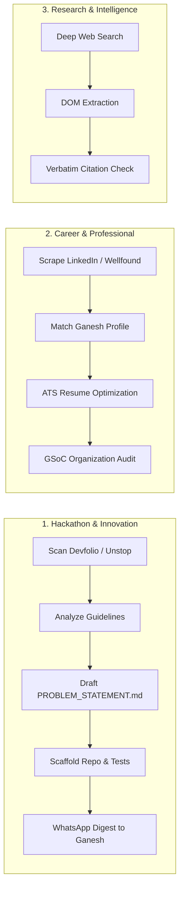

# Project JARVIS: Departmental Structure & Workflows

> **Governing Directive**: *"Rule 3: Build Departments. Career Department (LinkedIn Scout, Internship Scout, Job Scout, Resume Agent, Interview Agent). Hackathon Department (Hackathon Scout, Guideline Analyzer, Problem Selector, Tech Stack Planner, Repo Creator). Purpose: Improve Ganesh's career."*

---

## 1. Department Overview

Project JARVIS structures all capabilities into 6 functional departments. Each department contains dedicated managers, worker agents, standardized workflows, and concrete deliverables.



---

## 2. Department Specifications

### Department 1: Hackathon & Innovation
- **Department ID**: `hackathon`
- **Manager**: `hackathon_manager`
- **Mission**: Continuously monitor national and international hackathons (Devfolio, Unstop, MLH, Hackerearth), evaluate prize tracks, and scaffold production-ready solutions before the competition deadline.
- **Worker Roster**:
  - `hackathon_scout`: Scrapes listings, filters for AI/Agentic/Systems themes, extracts prize amounts.
  - `guideline_reader`: Ingests hackathon rulebooks, evaluates judging criteria and team constraints.
  - `problem_selector`: Matches problem statements against Ganesh's strongest stack (Python, FastAPI, Local LLMs, React).
  - `prize_evaluator`: Calculates prize-to-effort ROI.
- **Standard Autonomous Workflow**:
  ```
  Devfolio/Unstop Scrape (12:00 IST Daily)
         ↓
  Filter High Prize / AI Track
         ↓
  Generate PROBLEM_STATEMENT.md
         ↓
  Scaffold starter app.py + requirements.txt
         ↓
  Generate .github/workflows/ci.yml
         ↓
  Send WhatsApp Digest to +919324094474
  ```

---

### Department 2: Career & Professional Growth
- **Department ID**: `career`
- **Manager**: `career_manager`
- **Mission**: Secure high-impact internships, optimize technical visibility for Google Summer of Code (GSoC), and maintain an exceptional GitHub developer profile.
- **Worker Roster**:
  - `internship_scout`: Scans Wellfound, LinkedIn, and AngelList for remote and Pune/Bangalore software roles.
  - `ats_resume_optimizer`: Tailors LaTeX/Markdown resumes to keyword match target job descriptions.
  - `gsoc_mentor_liaison`: Analyzes top GSoC open-source repositories (CNCF, Python Software Foundation, Linux Foundation), mapping open starter issues.
  - `profile_auditor`: Continuously checks GitHub public profile (`GaneshNair007`) for verified badges, pinned repositories, and commit velocity.
- **Deliverables**:
  - `data/career_pipeline.json`: Active tracking pipeline of submitted and open applications.
  - `data/resumes/`: Cryptographically sanitized, targeted resume variations.

---

### Department 3: Research & Intelligence
- **Department ID**: `research`
- **Manager**: `research_manager`
- **Mission**: Conduct deep-dive technical investigations, synthesize state-of-the-art AI papers, and evaluate new open-source repositories before adoption.
- **Worker Roster**:
  - `web_scout`: Executes targeted multi-engine queries (SearXNG, Google, arXiv).
  - `citation_extractor`: Extracts exact URL citations and page snippets, eliminating hallucinations.
  - `competitive_analyst`: Benchmarks alternative frameworks against JARVIS target latency (<500ms).
  - `deep_reasoner`: Frontier model reasoning synthesis (OpenRouter DeepSeek R1 / Gemini 2.0 Flash Thinking).
- **Deliverables**:
  - `data/artifacts/research/`: Structured research dossiers with methodology, code examples, and trade-off tables.

---

### Department 4: Software Engineering & Systems
- **Department ID**: `engineering`
- **Manager**: `eng_manager`
- **Mission**: Design, author, test, and maintain production-quality code across Project JARVIS with rigorous test coverage (>80%).
- **Worker Roster**:
  - `system_architect`: Authors architectural blueprints, DAG schemas, and data flow diagrams.
  - `backend_developer`: Implements robust FastAPI routes, Pydantic schemas, and database migrations.
  - `frontend_developer`: Maintains web dashboard, SSE event streaming, and responsive desktop interfaces.
  - `test_engineer`: Authors pytest test suites covering edge cases, concurrency, and error handling.
  - `ast_code_mapper`: Parses repository AST trees into symbol index tables for instant context injection.
- **Deliverables**:
  - Verified modular Python code under `jarvis/`.
  - Comprehensive unit and integration test suites under `tests/`.

---

### Department 5: Cybersecurity & Secret Protection
- **Department ID**: `security`
- **Manager**: `security_manager`
- **Mission**: Enforce the 10-Layer Security Shield across all computational lifecycles, guaranteeing zero credential leaks.
- **Worker Roster**:
  - `dlp_auditor`: Presidio real-time redaction of passwords, tokens, and PII.
  - `entropy_secret_scanner`: Shannon entropy evaluation to catch random API keys and hashes.
  - `git_shield_agent`: Pre-commit hook inspection blocking unencrypted secrets from entering git history.
  - `merkle_integrity_auditor`: Maintains append-only hash chain of all system actions in `data/security_audit_merkle.jsonl`.
- **Deliverables**:
  - `jarvis/security/ten_layer_shield.py`: Production-verified security coordinator.
  - `.pre-commit-config.yaml` & `scripts/git_pre_commit_hook.py`: Active git security barrier.

---

### Department 6: Operations & Infrastructure
- **Department ID**: `operations`
- **Manager**: `ops_manager`
- **Mission**: Manage local compute hardware (Lenovo LOQ RTX 4050 6GB VRAM), cloud API keys, and background daemons.
- **Worker Roster**:
  - `gpu_allocator`: Balances VRAM allocation between Kokoro-TTS, Faster-Whisper, and local Ollama models.
  - `api_rotator_daemon`: Monitors rate-limit quotas and health across Google Gemini, OpenRouter, and Groq keys.
  - `process_supervisor`: Supervises background FastAPI server, SSE stream connections, and scheduled tasks.
  - `openmaus_dispatcher`: Drives the OpenMausBot Grok multi-persona engine.
- **Deliverables**:
  - `jarvis/core/api_key_rotator.py`: Multi-provider load-balanced key rotator.
  - `jarvis/core/voice_stream.py`: Low-latency streaming perception loop.
