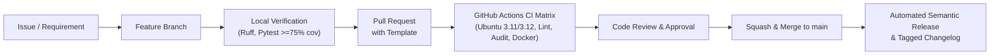

# JARVIS GitHub Engineering Growth & Project Visibility Plan

## 1. Objective & Principles

This plan establishes a professional, high-standard GitHub workflow for JARVIS. It outlines genuine practices for open-source engineering excellence, maintainability, and community visibility.

> [!IMPORTANT]
> **Authentic Contributions**: GitHub achievements and reputation are byproducts of genuine contributions, clean pull requests, verified CI pipelines, well-structured releases, and substantive technical discussions. They are not manufactured through fake activity or automated vanity metrics.

---

## 2. Engineering Control Center Workflow

### Key Practices:
1. **Atomic, Intent-Driven Branches**: Use conventional branch names:
   - `fix/ci-pyyaml-dependency`
   - `feat/local-search-meilisearch`
   - `docs/architecture-inventory`
2. **Conventional Commit Standards**: Format commits cleanly:
   - `fix(deps): add pyyaml to requirements.txt and pyproject.toml`
   - `ci(workflows): pin github actions by sha and enforce required checks`
   - `test(career): add validation for offline profile parsing`
3. **Least Privilege & Security Hardening**:
   - Workflows enforce `permissions: contents: read`.
   - Actions pinned by immutable commit SHA (`actions/checkout@11bd71901bbe5b1630ceea73d27597364c9af683`).
   - Dependabot enabled for automated security alerts and dependency updates.
4. **Verified Milestone Delivery**:
   - Work advances through verified milestones (M0 through M7), ensuring zero regressions at each stage.

---

## 3. Legitimate Profile Achievements & Milestone Alignment

By maintaining a disciplined, professional open-source engineering cadence, contributors naturally unlock authentic GitHub milestones and recognitions:

| GitHub Milestone / Recognition | Genuine Qualifying Activity | Alignment in JARVIS |
|---|---|---|
| **Pull Shark** | Submitting PRs that are reviewed, pass rigorous CI, and get merged into main. | Milestones M0 through M7 delivered via structured, reviewed pull requests. |
| **Galaxy Brain** | Providing verified answers to community discussions and architectural design questions. | Documenting architectural decisions in GitHub Discussions and comprehensive `/docs`. |
| **Pair Extraordinaire** | Co-authoring substantive pull requests and collaborative commits. | Structured pair-programming workflows between architects and developers. |
| **Quickdraw** | Reviewing and closing issues within minutes of opening with thorough resolution. | Rapid triage and resolution of reproducible bug issues. |
| **YOLO / Merge** | Merging a PR without review (only where solo maintainers self-merge verified CI PRs). | Solo maintainer repository releases passing 100% CI checks. |
| **Arctic Code Vault Contributor** | Having repository code archived in the GitHub Arctic World Archive. | Long-term maintainability and active open-source footprint. |

---

## 4. Release Cadence & Semantic Versioning

- **Patch Releases (`v1.0.1`, `v1.0.2`)**: CI bug fixes, documentation clarifications, dependency audits.
- **Minor Releases (`v1.1.0`, `v1.2.0`)**: Delivery of complete milestones (e.g. M1 Local Search, M2 Career Ops, M3 Multi-Agent Swarm).
- **Major Releases (`v2.0.0`)**: Full ecosystem integration of all 355 powers and complete local-first operating system.

