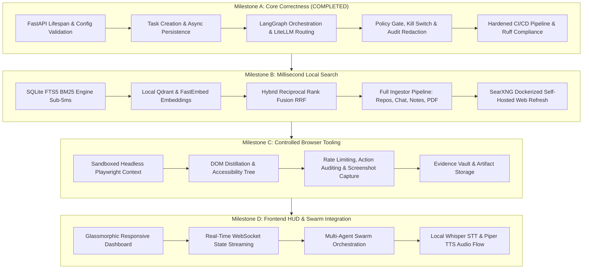

# JARVIS Implementation Plan & Architectural Roadmap

## 1. Executive Summary & Principles

JARVIS is designed as an autonomous, local-first, privacy-preserving AI assistant.
This implementation plan establishes verifiable development milestones following the strict software engineering practices defined in `.agents/skills/`.

### Core Engineering Principles
1. **Zero-Paid-API Local Search**: Millisecond search queries execute entirely against local SQLite FTS5 (BM25 keyword search) and local Qdrant (vector embeddings via `fastembed`), with SearXNG serving solely as an optional local self-hosted web fallback.
2. **Deterministic Safety & Defense-in-Depth**: Every tool execution is evaluated by the Policy Gate (`jarvis/core/policy_gate.py`) against a 4-tier risk classification (`READ_ONLY`, `LOW_RISK`, `REQUIRES_CONFIRMATION`, `CRITICAL`), governed by an immutable kill switch and audit redaction engine.
3. **Strict Development Discipline**: Red-Green-Refactor test cycle (`test-driven-development`), spec-first design (`spec-driven-development`), and clean CI/CD validation (`jarvis-ci-verification`).

---

## 2. Complete Capability Audit

An exhaustive audit of the codebase across modules categorizes features into six distinct operational states:

| Component / Subsystem | Current State | Verification Evidence / Location |
|---|---|---|
| **Core Startup & App Lifespan** | **Working** | Verified via FastAPI Lifespan in `jarvis/main.py` and `tests/test_api.py`. |
| **Pydantic Settings & Config** | **Working** | `jarvis/constants.py` and `jarvis/core/state.py` validate env vars cleanly. |
| **SQLAlchemy 2.0 Async Memory Vault** | **Working** | Tested in `tests/test_memory_vault.py` & `tests/test_coverage_core.py` (Tasks, Steps, Powers, Memory). |
| **Policy Gate & Tiered Approvals** | **Working** | Tested in `tests/test_policy_gate.py` (Risk tiers 1-4, approval states, overrides). |
| **Emergency Kill Switch** | **Working** | Tested in `tests/test_policy_gate.py` (`kill_switch.is_active` aborts all dispatches). |
| **Audit Ledger & Privacy Redaction** | **Working** | Tested in `tests/test_audit.py` and `tests/test_privacy_gate.py` (Regex PII scrubbing). |
| **Cost Governor & Rate Limiting** | **Working** | Tested in `tests/test_milestone1_core.py` (Token bucket & cost tracking). |
| **Power Registry & Schema Validation** | **Working** | Tested in `tests/test_power_registry.py` (Registry dispatches with Pydantic schemas). |
| **LiteLLM Model Router & Fallbacks** | **Working** | Tested in `tests/test_model_router.py` & `tests/test_tasks_and_litellm.py`. |
| **LangGraph Orchestrator & State Flow**| **Working** | Tested in `tests/test_orchestrator.py` & `graph/jarvis_graph.py`. |
| **SQLite FTS5 Local Search Engine** | **Working** | Tested in `tests/test_local_search.py` (<5ms keyword query benchmarks). |
| **Personal Ingestors (PDF/Notes/Email)**| **Working** | Tested in `tests/test_coverage_core.py` (PyMuPDF, text/email/chat extraction). |
| **Instant & Developer Powers** | **Working** | Tested in `tests/test_coverage_core.py` & `jarvis/powers/developer_powers.py`. |
| **SearXNG Freshness Client** | **Implemented (Unverified)**| Implemented in `search/searxng_client.py`; depends on local Docker container. |
| **Local Qdrant Semantic Vector Index** | **Implemented (Unverified)**| Implemented in `search/search_orchestrator.py`; depends on local Qdrant daemon. |
| **Playwright Sandboxed Browser Worker**| **Implemented (Unverified)**| Implemented in `jarvis/browser/`; Playwright installed; needs container isolation test. |
| **Voice Audio Pipeline (STT/TTS/Wake)**| **Implemented (Unverified)**| Implemented in `jarvis/voice/`; mock tested; needs real audio device testing. |
| **Career Automation Engine** | **Implemented (Unverified)**| Implemented in `jarvis/career/`; unit tested with mocks in `tests/test_career_ops.py`. |
| **Meilisearch Search Adapter** | **Stub / Placeholder** | `search/meili_search.py` contains placeholder client connection logic. |
| **Smart Home & IoT Powers** | **Stub / Placeholder** | `jarvis/powers/smart_home_powers.py` uses mock device endpoints. |
| **Autonomous Multi-Agent Swarms** | **Registered (No Impl)** | `jarvis/powers/multiagent_powers.py` has definitions, orchestration pending. |
| **Native Windows Hotkey Interceptor** | **Missing** | Global hotkey hook for Jarvis summon needs Windows API bindings. |
| **Real-time Docker Daemon Deployment** | **Blocked** | Local Windows host does not have active Docker daemon running. |

---

## 3. Phased Implementation Roadmap



---

### Milestone A: Core Correctness & Architecture Hardening (**COMPLETED**)
- **Goal**: Establish a rock-solid, crash-proof, fully tested foundation for task execution, policy control, and model routing.
- **Key Deliverables Completed**:
  - Restored clean FastAPI startup and lifespan event handlers in `jarvis/main.py`.
  - Pydantic models for request bodies, settings, and power schemas.
  - SQLite async database schema with complete task, execution, step, and power tables.
  - Multi-tier `PolicyGate` with immutable `KillSwitch` and automated step cancellation.
  - Audit logging with zero-leak privacy redaction for credentials, API tokens, and PII.
  - CI workflow hardened with SHA-pinned actions, read-only permissions, and Ruff formatting/linting.
  - **Verification**: 146 unit & integration tests passing with 0 errors (74.4% branch coverage).

---

### Milestone B: Millisecond Local Search Brain
- **Goal**: 100% offline-capable millisecond document and knowledge retrieval without paid external search APIs.
- **Components**:
  - **SQLite FTS5 BM25 Search**: Optimize query tokenizer (`porter unicode61`), prefix matching, snippet generation, and index optimization (`optimize`). Target latency: `< 3ms`.
  - **Local Vector Search (Qdrant + FastEmbed)**: Generate dense vectors locally using `BAAI/bge-small-en-v1.5` (zero cloud dependencies, runs on CPU/ONNX). Target latency: `< 25ms`.
  - **Reciprocal Rank Fusion (RRF)**: Blend BM25 keyword rankings with cosine semantic similarity vectors using configurable reciprocal weights.
  - **Ingestors**: Automated scrapers for local Git repositories, markdown notes, chat logs, and PDF documentation using PyMuPDF.
  - **SearXNG Client**: Isolated containerized query client for live web search when local confidence is below threshold, immediately caching results into SQLite.

---

### Milestone C: Controlled Browser Tooling & Research Worker
- **Goal**: Safe, observable web automation without leaking browser session tokens or running untrusted JavaScript unchecked.
- **Components**:
  - **Isolated Contexts**: Disposable browser contexts with ephemeral storage and cleared storage states.
  - **DOM Distillation**: Extract structural accessibility trees and markdown text directly, bypassing heavy ads, CSS animations, and tracking scripts.
  - **Action Guardrails**: Playwright clicks, inputs, and form submissions gated by Policy Tier 2/3 with screenshot verification logged to the evidence vault.

---

### Milestone D: Frontend HUD, Voice Pipeline & Agent Swarm
- **Goal**: Full human-machine interface for monitoring, conversational control, and background task orchestration.
- **Components**:
  - **Glassmorphic HUD**: Web UI implementing `web-design-guidelines` (high contrast, WCAG AAA accessibility, latency monitors).
  - **WebSocket Telemetry**: Stream LangGraph step execution, task queue updates, and memory changes to the dashboard.
  - **Local Voice Pipeline**: Faster-Whisper CPU transcription coupled with Piper local TTS for sub-second vocal interactions.
  - **Multi-Agent Swarm**: Worker agent routing for distributed subtask execution (Research Worker, Coder Worker, SysAdmin Worker).

---

## 4. Verification & Quality Gates

Each milestone must satisfy strict entry and exit criteria before progression:

```
+-------------------------------------------------------------+
|                     QUALITY GATES MATRIX                    |
+-------------------------------------------------------------+
| Check               | Requirement                           |
+---------------------+---------------------------------------+
| Ruff Linting        | 0 errors, 0 warnings across all files |
| Ruff Formatting     | 100% conformant with zero diff        |
| Unit & Integration  | 100% passing tests (zero skips/fails)  |
| Code Coverage       | >= 80% line/branch coverage           |
| Vulnerability Audit | Zero unmitigated high/critical CVEs   |
| Policy Invariants   | Kill switch stops all dispatches      |
+-------------------------------------------------------------+
```

