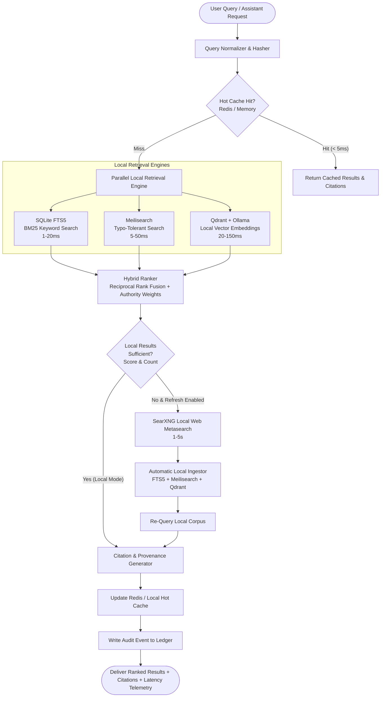

# JARVIS Local Search Brain Architecture

## 1. Architectural Philosophy: The Private, Millisecond-Speed Brain

JARVIS Local Search is engineered as a **private, local-first, zero-cloud search brain**. 

Traditional personal assistants rely on third-party cloud APIs (Google Custom Search, Bing Web Search, OpenAI/Cohere embedding endpoints) which:
1. Leak sensitive local files, source code, personal emails, and private notes to remote providers.
2. Introduce cloud network latencies (300ms–2000ms+ per lookup).
3. Introduce recurring operational costs and API rate-limiting failure modes.

JARVIS reverses this paradigm:
- **Corpus First**: Searches your indexed local corpus (PDFs, Markdown notes, Git repositories, chat logs, server documentation, browser pages, YouTube transcripts) in milliseconds.
- **Local Embeddings**: Runs semantic vectorization on-device through Ollama (`nomic-embed-text`) or in-memory fallback; vectors are stored in local Qdrant.
- **Zero-Cloud Keyword Search**: Instant BM25 ranked search powered by SQLite FTS5 (`porter unicode61`) and Meilisearch.
- **Fresh Web as Fallback Only**: SearXNG is queried strictly when local search confidence falls below threshold. All fetched web results are immediately ingested, indexed, and cached locally so identical future queries resolve in milliseconds.

---

## 2. System Architecture Diagram



---

## 3. Storage & Retrieval Layers

| Layer | Engine / Technology | Latency Target | Core Purpose |
| :--- | :--- | :--- | :--- |
| **Hot Query Cache** | Redis + In-Memory TTL Dict | `< 5 ms` | Microsecond cache for repeated search queries and session contexts |
| **Keyword Search** | SQLite FTS5 (`porter unicode61`) | `1 – 20 ms` | BM25 ranked full-text search with highlighted snippet generation |
| **Instant / Typo-Tolerant** | Meilisearch (`jarvis_docs`) | `5 – 50 ms` | Search-as-you-type dashboard search with typo tolerance |
| **Semantic Vector Index** | Qdrant + Ollama (`nomic-embed-text`) | `20 – 150 ms` | Cosine similarity semantic search over conceptual meanings |
| **Raw Archive** | SQLite `documents` table | `1 – 10 ms` | Source of truth, content deduplication (SHA-256), soft deletion |
| **Fresh Web Metasearch**| SearXNG (Self-hosted) | `1 – 6 sec` | Fallback-only live web lookup; feeds directly into local ingestor |

---

## 4. SQLite FTS5 Schema

```sql
-- Source of truth archive table with content deduplication
CREATE TABLE IF NOT EXISTS documents (
    doc_id TEXT PRIMARY KEY,
    source_type TEXT NOT NULL,
    source_url TEXT,
    title TEXT NOT NULL,
    content TEXT NOT NULL,
    content_hash TEXT UNIQUE,
    metadata_json TEXT,
    provenance_json TEXT,
    permissions_json TEXT,
    created_at TEXT DEFAULT CURRENT_TIMESTAMP,
    updated_at TEXT DEFAULT CURRENT_TIMESTAMP,
    deleted_at TEXT
);

-- SQLite FTS5 Virtual Table for sub-millisecond keyword retrieval
CREATE VIRTUAL TABLE IF NOT EXISTS search_index USING fts5(
    doc_id UNINDEXED,
    source_type UNINDEXED,
    source_url UNINDEXED,
    title,
    content,
    metadata_json UNINDEXED,
    tokenize = 'porter unicode61'
);

-- Search query audit telemetry table
CREATE TABLE IF NOT EXISTS search_queries (
    query_id TEXT PRIMARY KEY,
    user_id TEXT,
    query TEXT NOT NULL,
    mode TEXT NOT NULL,
    providers_used TEXT,
    result_count INTEGER,
    latency_ms REAL,
    created_at TEXT DEFAULT CURRENT_TIMESTAMP
);

-- Verifiable citation store
CREATE TABLE IF NOT EXISTS citations (
    citation_id TEXT PRIMARY KEY,
    doc_id TEXT NOT NULL,
    query_id TEXT,
    title TEXT NOT NULL,
    url TEXT,
    excerpt TEXT NOT NULL,
    score REAL,
    provider TEXT,
    created_at TEXT DEFAULT CURRENT_TIMESTAMP
);
```

---

## 5. Hybrid Ranking Algorithm (Reciprocal Rank Fusion + Authority Weights)

JARVIS combines keyword and semantic rankings using an enhanced Reciprocal Rank Fusion formula:

$$\text{RRF Score}(d) = \sum_{p \in \text{Providers}} w_p \cdot \frac{1}{k + \text{rank}_p(d)} \times \alpha_{\text{source}} \times \beta_{\text{recency}}$$

Where:
- $k = 60$ (Standard RRF smoothing constant).
- $w_{\text{keyword}} = 0.55$, $w_{\text{semantic}} = 0.45$.
- $\alpha_{\text{source}}$: Source authority modifier:
  - `repo`, `notes`, `file`: $1.20\times$ (High user authority).
  - `pdf`, `document`: $1.15\times$.
  - `web`, `browser`: $1.00\times$.
- $\beta_{\text{recency}}$: Exponential decay based on document creation date:
  $$\beta = 1.0 + 0.1 \cdot \exp\left(-\frac{\Delta t_{\text{days}}}{30}\right)$$

---

## 6. Citation & Provenance Rules

Every search result produced by the JARVIS Search Brain includes structured provenance:
- **Citation ID**: Cryptographically deterministic identifier `cit_<doc_id>_<sha256(excerpt)[:8]>`.
- **Source Type & URL/File Path**: Exact location of the originating asset.
- **Indexed Date & Provenance**: Ingestion timestamp, original author/repo metadata, and integrity checksum.
- **Verifiable Excerpt**: The exact text segment supporting the search result.

No search result is ever returned without provenance.
