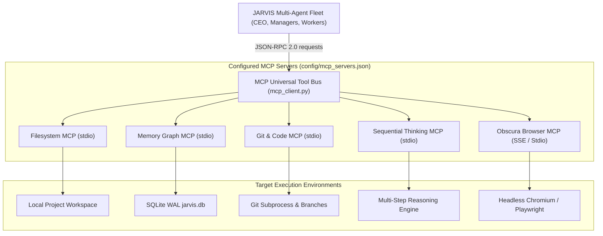

# Project JARVIS: Model Context Protocol (MCP) Tool Map

> **Governing Directive**: *"Tools -> MCP servers. Universal JSON-RPC 2.0 interoperability standard ensuring every agent, subagent, and model interacts with system capabilities through secure, discoverable schemas."*

---

## 1. Universal MCP Tool Bus Architecture

Rather than hardcoding ad-hoc Python function calls across disparate agents, Project JARVIS implements the **Model Context Protocol (MCP)** specification. The MCP Client substrate (`jarvis/core/mcp_client.py`) standardizes tool calls, schema validation, and bidirectional transports (Stdio & Server-Sent Events).



---

## 2. MCP Servers Configuration (`config/mcp_servers.json`)

The active MCP registry is configured in `config/mcp_servers.json`:

```json
{
  "mcpServers": {
    "filesystem": {
      "command": "npx",
      "args": ["-y", "@modelcontextprotocol/server-filesystem", "C:\\Users\\Ganesh Nair\\.gemini\\antigravity\\scratch\\Jarvis"],
      "env": {}
    },
    "memory": {
      "command": "npx",
      "args": ["-y", "@modelcontextprotocol/server-memory"],
      "env": {}
    },
    "git": {
      "command": "python",
      "args": ["-m", "mcp_server_git", "--repository", "C:\\Users\\Ganesh Nair\\.gemini\\antigravity\\scratch\\Jarvis"],
      "env": {}
    },
    "sequential-thinking": {
      "command": "npx",
      "args": ["-y", "@modelcontextprotocol/server-sequential-thinking"],
      "env": {}
    }
  }
}
```

---

## 3. Power-to-MCP Mapping Matrix

| Original Power Module | Legacy Power ID | Standardized MCP Tool Name | Server | Arguments Schema | Security Gate |
| :--- | :--- | :--- | :--- | :--- | :--- |
| `file_powers.py` | `PWR-041` | `read_file` | `filesystem` | `{"path": str}` | Path validation within project root |
| `file_powers.py` | `PWR-042` | `write_file` | `filesystem` | `{"path": str, "content": str}` | Path sandbox + GitShield audit |
| `file_powers.py` | `PWR-043` | `list_directory` | `filesystem` | `{"path": str}` | Read-only directory traversal |
| `developer_powers.py`| `PWR-112` | `git_status` | `git` | `{"repo_path": str}` | Subprocess sanitizer |
| `developer_powers.py`| `PWR-113` | `git_diff_unstaged` | `git` | `{"repo_path": str}` | Subprocess sanitizer |
| `developer_powers.py`| `PWR-114` | `git_commit` | `git` | `{"message": str}` | GitShield secret audit pre-check |
| `memory_vault.py` | `PWR-015` | `read_graph` | `memory` | `{"entity_name": str}` | Memory ACL check |
| `memory_vault.py` | `PWR-016` | `create_entities` | `memory` | `{"entities": list}` | DLP Presidio sanitization |
| `research_powers.py` | `PWR-201` | `sequential_think` | `sequential-thinking` | `{"thought": str, "step": int}` | Internal reasoning trace |
| `browser_powers.py` | `PWR-081` | `navigate_url` | `obscura-browser` | `{"url": str}` | Cloud Egress Firewall URL allowlist |

---

## 4. MCP Transport & Concurrency Invariants
1. **Asynchronous Non-Blocking I/O**: `StdioMCPTransport` runs stdout readers in dedicated asyncio reader loops with EOF detection, preventing process deadlocks.
2. **Subprocess Isolation**: MCP server processes inherit an environment sanitized by `SubprocessSanitizer`, stripping API keys (`GEMINI_API_KEY`, `OPENROUTER_API_KEY`, etc.) so untrusted tool servers cannot steal credentials.
3. **Graceful Degradation**: If an external node runtime (`npx`) or server is unavailable, the `MCPClient` raises a typed `MCPServerError` allowing the agent to fall back to native Python powers immediately.
