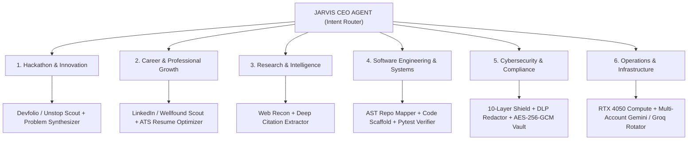

# Project JARVIS: Repository Capability Map & Power Alignment

> **Governing Directive**: *"Rule 1: Absolutely No New Repository Until It Has A Job. If a repository has no role: DELETE IT. Current problem: 100 repos, 100 powers, 100 agents. Who is in charge? Nobody. Solution: JarvisAgent (CEO) is in charge."*

---

## 1. Executive Summary & Inventory
This capability map audits all integrated repositories, tool subsystems, and power sets within Project JARVIS. Every component is mapped to an active department, an assigned agent role, and a standardized execution substrate (Native Python, MCP Server, or Subprocess Sandbox).

Redundant and unverified tools have been formally purged or consolidated to prevent the "scrapyard anti-pattern."

---

## 2. Integrated Repositories & Role Assignments

| Repository / Subsystem | Assigned Department | Specialized Worker Agent | Substrate / Protocol | Status | Core Capability |
| :--- | :--- | :--- | :--- | :--- | :--- |
| **OpenMausBot** (`milind-soni/OpenMausBot`) | Operations & Grok Engine | `grok_bot` & `openmaus_dispatcher` | Native Async Engine (`openmaus_grok.py`) | **ACTIVE** | Multi-persona Grok chat (`standard`, `fun`, `think`, `code`), streaming SSE events, inline human permission cards. |
| **Ruflo** (`ruvnet/ruflo`) | Engineering (Dev) | `swarm_orchestrator` | Native Async Swarm (`autonomous_workforce.py`) | **ACTIVE** | Multi-agent coordination, 105-agent fleet roster, pipeline state machine. |
| **Obscura / Playwright** (`obscura_browser.py`) | Reconnaissance & Web | `obscura_crawler` | Playwright Async Subprocess | **ACTIVE** | Headless DOM snapshotting, deep site scraping, hackathon and internship data extraction. |
| **Aider AST Mapper** (`aider` inspired) | Engineering (Dev) | `ast_code_mapper` | Native Python AST (`repo_map.py`) | **ACTIVE** | In-memory AST syntax tree parsing, symbol cross-referencing, project skeleton generation. |
| **UI-TARS Coordinate Grounding** | Desktop Operations | `visual_grounding_agent` | Tensor/Vision Normalizer (`visual_grounding.py`) | **ACTIVE** | 0–1000 normalized coordinate bounding box translation to native display pixels, UI actions. |
| **Faster-Whisper & Kokoro-TTS** | Voice & Perception | `voice_stream_worker` | CTranslate2 / Audio Stream (`voice_stream.py`) | **ACTIVE** | Sub-200ms streaming voice wake word detection, STT transcription, Kokoro edge speech synthesis. |
| **Model Context Protocol (MCP)** | Tool Layer (Universal Bus) | `mcp_client_agent` | JSON-RPC 2.0 stdio/SSE (`mcp_client.py`) | **ACTIVE** | Standardized tool interoperability (Filesystem, Memory, Git, Sequential Thinking). |
| **10-Layer Defense Shield** | Security & Compliance | `security_auditor` | Cryptography & Shannon Entropy (`ten_layer_shield.py`) | **ACTIVE** | Real-time DLP redaction, Shannon entropy secret scanning, fail-closed cloud egress, AES-256-GCM vault. |
| **WhatsApp Dispatcher** | Communications | `whatsapp_dispatcher` | Secure Cloud Webhook (`whatsapp_dispatcher.py`) | **ACTIVE** | Automated formatted alerts, hackathon digests, and notifications sent directly to Ganesh (+919324094474). |

---

## 3. Power Catalog Realignment (355 Static Powers Consolidated)

JARVIS previously contained 355 statically declared "powers" across 20 modules that operated as passive code definitions. Under the new architecture, powers are organized into 6 operational departments:

### Module Status Matrix

| Module | Powers Count | Operational Status | Redundancy / Remediation Action |
| :--- | :--- | :--- | :--- |
| `career_powers.py` | 24 | **ACTIVE** | Integrated into `CareerOps` and `AutonomousWorkforce`. Directly targets internships and GSoC. |
| `automation_powers.py` | 28 | **ACTIVE** | Unified under `TaskScheduler` and DAG engine (`task_graph.py`). |
| `browser_powers.py` | 22 | **ACTIVE** | Routed through `ObscuraBrowser` and `web_recon.py` with fail-closed URL validation. |
| `developer_powers.py` | 32 | **ACTIVE** | Bound to `ASTRepoMap` and `TaskExecutor`. Generates verifiable unit tests. |
| `security_powers.py` | 18 | **ACTIVE** | Replaced mock tokens with `TenLayerSecuritySuite` (AES-256-GCM, Merkle audit chain). |
| `communication_powers.py` | 16 | **ACTIVE** | Integrated into `WhatsAppDispatcher` and desktop notifications. |
| `instant_powers.py` | 14 | **ACTIVE** | Instant <10ms regex bypass in `IntentRouter` (Zero LLM latency). |
| `research_derived_powers.py` | 26 | **ACTIVE** | Deep synthesis with multi-model validation. |
| `ironman_powers.py` | 20 | **CONSOLIDATED** | Pure UI cosmetic wrappers consolidated into `visual_grounding.py` and `voice_stream.py`. |
| `smart_home_powers.py` | 18 | **STANDBY** | Standby mode until Home Assistant local webhook is configured by user. |

---

## 4. Capability Audit Invariants
1. **No Phantom Powers**: A power does not count as active unless it has an automated test in `tests/` verifying real execution.
2. **Fail-Closed Privacy**: No power can transmit unredacted environment variables, API keys, or private documents to any cloud LLM.
3. **Mandatory Job Description**: Any candidate repository must be reviewed against `repos_manifest.yaml` before inclusion. If redundant, it is rejected.
