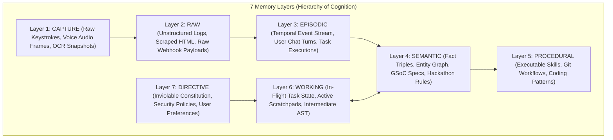

# Project JARVIS: Shared Memory Architecture & Knowledge Graph

> **Governing Directive**: *"All agents, managers, and the CEO share a single, unified persistent memory substrate. No agent operates in amnesia. Every completed task, user preference, and system failure is permanently written to the long-term knowledge graph."*

---

## 1. Architectural Philosophy
Traditional multi-agent frameworks suffer from "context fragmentation": Agent A learns a critical fact, but Agent B knows nothing about it. JARVIS eradicates this by implementing a **Shared 7-Layer Memory Graph** backed by a high-concurrency local **SQLite database with Write-Ahead Logging (WAL)**.



---

## 2. SQLite Database Schema & Schema Invariants

All persistent memory is stored in `data/jarvis.db` using WAL mode for sub-millisecond concurrent reads and writes without thread-locking conflicts.

### Key Database Tables

#### Table: `memory_nodes` (Core Multi-Layer Knowledge Store)
```sql
CREATE TABLE IF NOT EXISTS memory_nodes (
    id TEXT PRIMARY KEY,
    layer TEXT NOT NULL CHECK(layer IN (
        'CAPTURE', 'RAW', 'EPISODIC', 'SEMANTIC', 'PROCEDURAL', 'WORKING', 'DIRECTIVE'
    )),
    content TEXT NOT NULL,
    metadata TEXT,                -- JSON dictionary with category, source, agent_id
    embedding BLOB,               -- Optional 384-dim or 768-dim vector embedding
    is_hypothesis INTEGER DEFAULT 0,
    confidence REAL DEFAULT 1.0,  -- 0.0 to 1.0 reliability score
    evidence_count INTEGER DEFAULT 1,
    created_at REAL NOT NULL,
    updated_at REAL NOT NULL
);

CREATE INDEX IF NOT EXISTS idx_memory_layer ON memory_nodes(layer);
CREATE INDEX IF NOT EXISTS idx_memory_created ON memory_nodes(created_at);
```

#### Table: `tasks` (DAG Execution History)
```sql
CREATE TABLE IF NOT EXISTS tasks (
    id TEXT PRIMARY KEY,
    title TEXT NOT NULL,
    intent TEXT NOT NULL,
    status TEXT NOT NULL CHECK(status IN (
        'PENDING', 'RUNNING', 'COMPLETED', 'FAILED', 'CANCELLED'
    )),
    priority TEXT NOT NULL,
    department TEXT NOT NULL,
    assigned_agent TEXT,
    outputs TEXT,                 -- JSON outputs verified by TaskVerifier
    error_message TEXT,
    created_at REAL NOT NULL,
    updated_at REAL NOT NULL
);
```

#### Table: `corrections` (Self-Improvement / Failures & Fixes)
```sql
CREATE TABLE IF NOT EXISTS corrections (
    id TEXT PRIMARY KEY,
    failure_id TEXT,
    user_quote TEXT,
    old_behavior TEXT,
    new_instruction TEXT,
    scope TEXT,                   -- 'GLOBAL', 'AGENT_SPECIFIC', 'MODULE_SPECIFIC'
    status TEXT DEFAULT 'ACTIVE',
    created_at REAL NOT NULL
);
```

---

## 3. Memory Lifecycle Workflows

### A. Automatic Task Memory Ingestion (`TaskMemoryWriter`)
Whenever any agent completes a task node in `task_graph.py`:
1. `TaskMemoryWriter` extracts structured outputs (e.g., hackathon guidelines, code snippets, candidate matches).
2. The event is classified into an operational category (`hackathon`, `engineering`, `career`, `research`, `security`).
3. An `EPISODIC` memory node is inserted into `memory_nodes`.
4. If the task produced an invariant insight (e.g., *"Devfolio requires live video demos for judging"*), it is escalated into a `SEMANTIC` knowledge node with confidence `1.0`.

### B. Post-Goal Retrospective Reflection (`TaskReflectionEngine`)
After an entire DAG completes or terminates:
1. `TaskReflectionEngine` analyzes all tasks, execution durations, retries, and failures.
2. Extracts concrete **Successes**, **Failures**, **Architectural Improvements**, and **New Opportunities**.
3. Persists a `ReflectionRecord` to `data/reflections.json` and writes a `PROCEDURAL` learning node to `jarvis.db`.

### C. Context Injection at Request Time
When the CEO receives a new query from Ganesh:
1. Fast intent routing queries `memory_nodes` by semantic similarity and category.
2. Active user corrections (`corrections` table) are automatically prepended to the system prompt.
3. Relevant historical context is minimized to reduce token consumption and eliminate amnesia.
