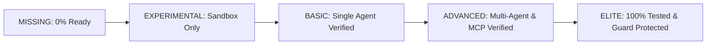

# JARVIS Capability Registry Architecture

## 1. Executive Summary

The **Capability Registry** (`jarvis/capabilities/`) maintains a real-time, database-synchronized catalog of all operational skills, tools, and cognitive capabilities within JARVIS. It replaces unstructured, unverified feature claims with strict **Maturity Levels** backed by test verification and historical success telemetry.

---

## 2. Capability Maturity Tiers

| Maturity Level | Criteria | Example Capabilities |
| :--- | :--- | :--- |
| **MISSING** | Identified gap with no working implementation | `autonomous_self_repair`, `automated_patent_search` |
| **EXPERIMENTAL** | Prototype code, unverified under load | `voice_interruption_vad`, `dynamic_mcp_hotplug` |
| **BASIC** | Single agent executable with verified basic tests | `desktop_ui_tars_grounding`, `kokoro_tts_edge` |
| **ADVANCED** | Multi-agent capable, integrated into CEO router & MCP | `ast_code_mapper`, `multi_account_rotator`, `openmaus_grok_engine` |
| **ELITE** | Zero-failure rate, 10-layer shield protected, production ready | `task_graph_engine`, `ten_layer_security_shield` |

---

## 3. Core Capabilities API & Methods

- `register_capability(name, level, category, description, required_tools, success_rate, metadata)`
- `update_capability(name, level, success_rate, description)`
- `list_capabilities(level, category)`
- `find_missing_capabilities()`
- `has_capability(name, minimum_level)`

### Architectural Guardrail:
The Capability Registry is strictly **read-only** with respect to production code files (`jarvis/`, `db/`, `app/`). When a missing capability is requested, the system cannot spontaneously write unverified code; it must emit a formal `ImprovementRequest`.
