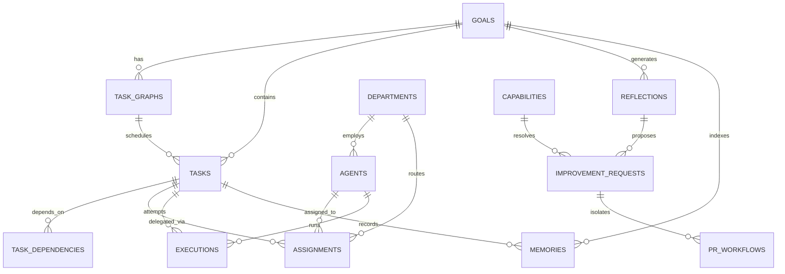

# JARVIS PostgreSQL Database Schema Specification

## 1. Architectural Overview

The JARVIS persistence tier transitions from transient key-value files to a robust, transactional relational schema backed by PostgreSQL and managed via Alembic migrations (`db/migrations/001` through `010`).

---

## 2. Migration Registry (`db/migrations/`)

| Migration | Target Tables | Primary Key | Key Foreign Keys | Purpose |
| :--- | :--- | :--- | :--- | :--- |
| **001** | `goals` | UUID | — | Strategic user goals & target timelines |
| **002** | `task_graphs`, `tasks`, `task_dependencies` | UUID | `goals.id`, `task_graphs.id`, `tasks.id` | DAG graph structure & dependency edges |
| **003** | `departments`, `agents`, `assignments` | UUID | `departments.id`, `agents.id`, `tasks.id` | Organizational CEO routing & worker rosters |
| **004** | `executions` | UUID | `tasks.id`, `agents.id`, `goals.id` | Run telemetry, duration, verification scores |
| **005** | `memories` | UUID | `tasks.id`, `goals.id` | Permanent episodic & semantic knowledge graph |
| **006** | `reflections` | UUID | `goals.id` | Post-mortem retrospectives & constitution scores |
| **007** | `capabilities` | UUID | — | 5-level maturity skill catalog |
| **008** | `improvement_requests`| UUID | `reflections.id`, `capabilities.id`| Backlog items for human review |
| **009** | `pr_workflows` | UUID | `improvement_requests.id` | Safe PR branch isolation & gatekeeping |
| **010** | `audit_events` | UUID | — | Append-only cryptographically verifiable audit log |

---

## 3. Index Strategy

High-frequency query filters are indexed to maintain sub-10ms response times:
- `status`: Indexed across `goals`, `task_graphs`, `tasks`, `agents`, `assignments`, `executions`, `improvement_requests`, and `pr_workflows`.
- `goal_id`: Foreign key indexed across `task_graphs`, `tasks`, `executions`, `memories`, `reflections`.
- `task_id`: Foreign key indexed across `task_dependencies`, `assignments`, `executions`, `memories`.
- `agent_id`: Foreign key indexed across `assignments`, `executions`.
