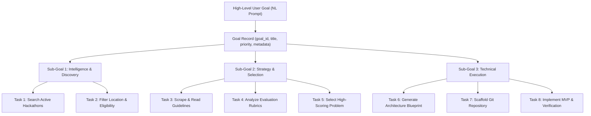
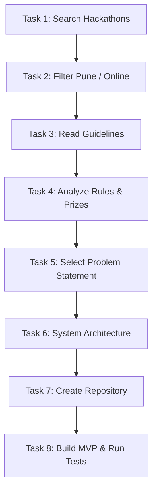

# JARVIS Goal Decomposition Architecture

## Executive Overview

Human prompts are inherently abstract, ambiguous, and non-deterministic (e.g., *"Help me win an AI hackathon"* or *"Get my GitHub ready for GSoC"*). Executing such prompts directly against a single agent leads to shallow completions, hallucinated outputs, or truncated responses.

JARVIS resolves this through the principle: **Everything Becomes a Task**. The Goal Decomposition Engine translates high-level strategic objectives into structured, deterministic, and topologically sorted Task Graphs (DAGs).

---

## 1. Goal-to-Task Hierarchy

---

## 2. Canonical Decomposition Case Study: "Help Me Win a Hackathon"

When the user specifies:
> *"Help me find and win an AI hackathon in Pune or online"*

The goal is decomposed into the following 8-task DAG:

| Task ID | Task Name | Department | Assigned Agent | Tool Requirements | Dependencies |
| :--- | :--- | :--- | :--- | :--- | :--- |
| `task_01` | Search Hackathons | Hackathon | `hackathon_scout` | `web_search`, `mcp_browser` | `[]` (Wave 0) |
| `task_02` | Filter Pune / Online | Hackathon | `hackathon_scout` | `data_filter` | `["task_01"]` |
| `task_03` | Read Guidelines | Hackathon | `guideline_reader` | `web_scrape`, `doc_parser` | `["task_02"]` |
| `task_04` | Analyze Rules & Rubrics | Hackathon | `prize_evaluator` | `deep_reasoner` | `["task_03"]` |
| `task_05` | Select Best Problem | Hackathon | `problem_selector` | `decision_matrix` | `["task_04"]` |
| `task_06` | Generate Architecture | Engineering | `system_architect` | `ast_mapper`, `mermaid_gen`| `["task_05"]` |
| `task_07` | Create Repository | Engineering | `backend_developer`| `git_cli`, `scaffold_engine`| `["task_06"]` |
| `task_08` | Build MVP & Roadmap | Engineering | `backend_developer`| `code_generator`, `pytest` | `["task_07"]` |

---

## 3. Dependency Graph & Parallel Wave Layout

The resulting DAG dependency edges are structured as:

Where multi-branch parallel tasks occur (e.g. conducting market analysis and evaluating prizes concurrently), the engine schedules them in identical execution waves without serial latency.

---

## 4. Context Passing Between Graph Nodes

To avoid massive monolithic prompts, each task receives only the targeted context it requires:
- When `Task 6 (Generate Architecture)` executes, its input context receives `outputs["task_05"]` (the selected problem statement) and `outputs["task_04"]` (the prize and rubric analysis).
- Raw scraped HTML from `Task 3` is distilled into structured JSON outputs, preventing context window exhaustion in downstream tasks.

---

## 5. Decomposing Complex Developer Workflows

Beyond hackathons, JARVIS goal decomposition applies uniformly to all engineering challenges:
1. **GSoC Profile Optimization**:
   - `Task 1`: Audit existing GitHub repos and commit history.
   - `Task 2`: Identify target open-source organizations (e.g., Python, Apache, Linux).
   - `Task 3`: Generate high-impact README profiles with verified badges and metric trackers.
   - `Task 4`: Prepare first pull request drafts and issue analysis.
2. **Security & Vulnerability Remediation**:
   - `Task 1`: AST code scan for hardcoded credentials.
   - `Task 2`: Git history scan for leaked tokens.
   - `Task 3`: Migrate secrets into DPAPI encrypted vault.
   - `Task 4`: Re-verify with 10-layer security shield.

