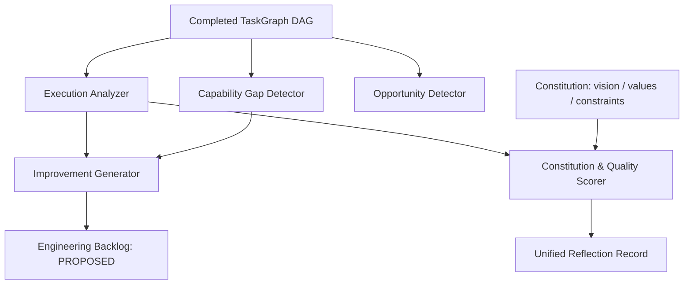

# JARVIS Reflection Engine Architecture

## 1. Executive Summary

The **Reflection Engine** (`jarvis/reflection/`) provides JARVIS with continuous self-awareness and retrospective intelligence. Rather than executing goals blindly, JARVIS systematically analyzes execution traces, scores performance against the **Constitution Layer**, detects capability gaps, and submits structured improvement proposals to the engineering backlog.

---

## 2. Core Subsystems

### 2.1 Execution Analyzer (`analyzer.py`)
- Ingests `TaskGraph` execution nodes, retries, and errors.
- Calculates completion percentage:
  $$\text{Completion Rate} = \frac{\text{Completed Tasks}}{\max(\text{Total Tasks}, 1)} \times 100$$
- Identifies execution bottlenecks where tasks required multiple retries or experienced execution latency.

### 2.2 Capability Gap Detector (`gap_detector.py`)
- Cross-references task `tool_requirements` against the active `CapabilityRegistry`.
- Detects missing tools, repeated failure signatures, and timeout trends.
- Assigns severity levels: `LOW`, `MEDIUM`, `HIGH`, `CRITICAL`.

### 2.3 Opportunity Detector (`opportunity_detector.py`)
- Extracts strategic insights and reusable assets from task execution outputs.
- Flags completed repositories, winning hackathon patterns, and reusable code workflows.

### 2.4 Improvement Generator (`improvement_generator.py`)
- Converts detected capability gaps and bottlenecks into validated `ImprovementProposal` records.
- Invariant: Emits proposals for human review; does **not** modify code autonomously.

### 2.5 Constitution Scorer (`scorer.py`)
- Reads `jarvis/constitution/` (`vision.yaml`, `values.yaml`, `constraints.yaml`).
- Enforces system invariants:
  - Verifies that 100% of completed tasks passed multi-stage QA and DLP gates.
  - Penalizes unhandled errors or policy bypasses.
  - Computes a normalized Constitution Alignment Score ($0.0$ to $1.0$).
