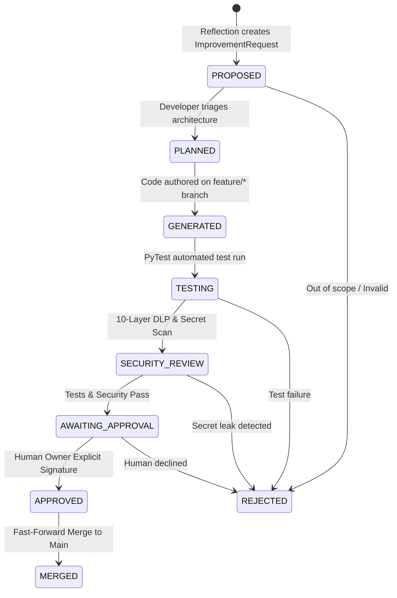

# JARVIS Safe PR Workflow & Human Gatekeeping

## 1. Executive Summary

Autonomous AI agents must not possess direct commit access to production master branches. The **Safe PR Workflow** (`jarvis/workflows/pr_workflow.py`) implements a state machine ensuring that all code enhancements undergo isolated development, automated security validation, and explicit human authorization.

---

## 2. PR Workflow State Machine

---

## 3. Workflow State Transition Rules

1. `PROPOSED` $\rightarrow$ `PLANNED`: Validates that the requested feature is architecturally sound and aligns with `jarvis/constitution/goals.yaml`.
2. `PLANNED` $\rightarrow$ `GENERATED`: Code changes are scaffolded exclusively on an isolated branch (`feature/imp-{id}`). Direct pushes to `main`, `master`, or `production` trigger an immediate `SecurityViolationError`.
3. `GENERATED` $\rightarrow$ `TESTING`: Executes comprehensive unit and integration suites.
4. `TESTING` $\rightarrow$ `SECURITY_REVIEW`: Runs Gitleaks, Bandit AST analysis, and the 10-Layer DLP Shield.
5. `SECURITY_REVIEW` $\rightarrow$ `AWAITING_APPROVAL`: Permitted **only** when `tests_passed == True` AND `security_passed == True`.
6. `AWAITING_APPROVAL` $\rightarrow$ `APPROVED`: **Human Gatekeeper**. Only the human owner (`ganesh`) can authorize approval. Autonomous agents attempting approval trigger an immediate security block.
7. `APPROVED` $\rightarrow$ `MERGED`: Merges the validated feature branch into `main`.
