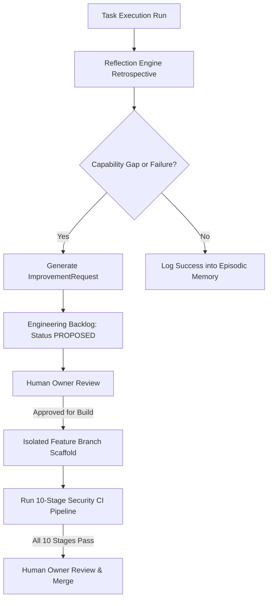

# JARVIS Self-Improvement Protocol

## 1. Principle of Governed Evolution

Self-improvement in JARVIS is governed by a foundational tenet:
> **Evolutionary Invariant**: *JARVIS can reflect on its flaws and design solutions, but it can never unilaterally modify production code or merge pull requests.*

---

## 2. The 4-Stage Self-Improvement Flow

1. **Reflection**: The `ReflectionEngine` analyzes executed graphs and evaluates compliance against the Constitution.
2. **Capability Gap**: `GapDetector` flags missing tools, execution timeouts, or failed quality checks.
3. **Improvement Request**: `ImprovementGenerator` packages the problem statement, affected tasks, and recommended remediation into an `ImprovementProposal`.
4. **Engineering Backlog**: The proposal is stored in the PostgreSQL database (`improvement_requests`) with state `PROPOSED`.

---

## 3. Strict Safety Invariants

- **Zero Autonomous Production Mod**: `ImprovementService.can_modify_production_code()` is hardcoded to `False`.
- **Branch Isolation**: Changes must target `feature/imp-*` branches.
- **Merge Gate**: Direct push or merge to `main` is physically blocked by `ArchitectureGuard.check_reflection_approval_bypass()` and GitHub branch protection.
