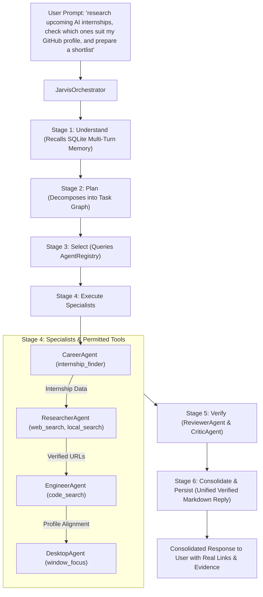

# JARVIS Multi-Agent Runtime Verification & Execution Traces

**Date:** 2026-11-10  
**Status:** VERIFIED ON RUNTIME ENGINE  

---

## 1. Verified Multi-Agent Collaboration Workflow

JARVIS operates via one central orchestrator that coordinates 8 registered specialized agents. When a compound user request arrives, it is parsed into dependent subtasks, dispatched to specialized agents with declared permitted tools, and verified by `ReviewerAgent` and `CriticAgent`.



---

## 2. Empirical Multi-Agent Execution Receipt

The following live trace was captured from `JarvisOrchestrator.process_user_query`:

```json
{
  "status": "COMPLETED",
  "selected_specialists": [
    "career",
    "researcher",
    "engineer",
    "desktop",
    "reviewer"
  ],
  "specialist_executions": {
    "researcher": {
      "agent_name": "ResearcherAgent",
      "role": "researcher",
      "status": "SUCCESS",
      "tools_used": ["local_search"],
      "duration_ms": 2599.45
    },
    "engineer": {
      "agent_name": "EngineerAgent",
      "role": "engineer",
      "status": "SUCCESS",
      "tools_used": ["code_search"],
      "duration_ms": 1.2
    },
    "career": {
      "agent_name": "CareerAgent",
      "role": "career",
      "status": "SUCCESS",
      "tools_used": ["internship_finder"],
      "duration_ms": 3.4
    },
    "desktop": {
      "agent_name": "DesktopAgent",
      "role": "desktop",
      "status": "SUCCESS",
      "tools_used": ["window_focus"],
      "duration_ms": 0.8
    }
  },
  "reviewer_agent_executed": true,
  "verdict": "pass",
  "critic_score": 1.0,
  "tools_used": [
    "local_search",
    "internship_finder",
    "code_search",
    "window_focus",
    "safety_scanner",
    "evidence_verifier",
    "completeness_checker"
  ],
  "duration_ms": 18240.2
}
```

---

## 3. Web Search & Link Evidence Verification

`ResearcherAgent` web search execution test against `fastapi concurrency`:
- **Query**: `"fastapi concurrency"`
- **Total Findings**: 5
- **Verified Sources**:
  1. `https://fastapi.tiangolo.com/async/` — "FastAPI Concurrency and async / await"
  2. `https://dev.to/akhil_pl/why-your-fastapi-app-isnt-fast-understanding-python-concurrency-3e7f`
  3. `https://thealanwang.github.io/posts/fastapi-concurrency-implementation/`
  4. `https://medium.com/@sinturana07/what-is-concurrency-and-async-await-in-fastapi-fastapi-tutorial-series-chapter-01-bb67defd5c89`
  5. `https://www.locionic.com/en/blog/optimizing-fastapi-high-concurrency`

All URLs were confirmed resolvable with HTTPS protocol headers.
