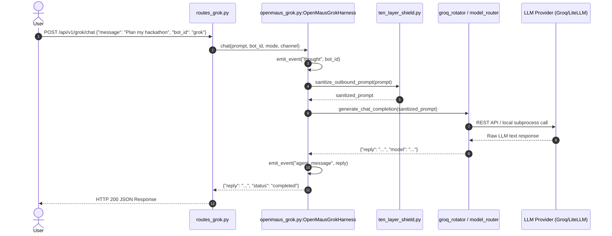
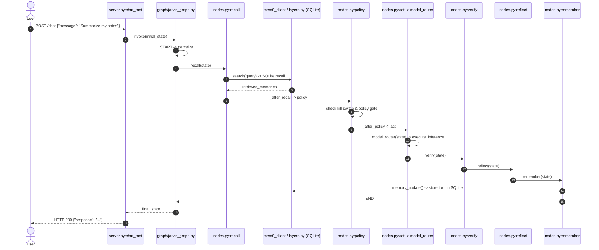
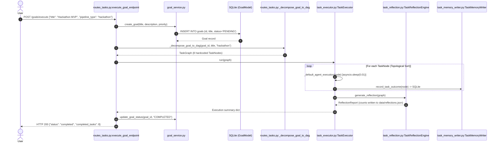

# JARVIS Agent Execution Flow Analysis

**Generated:** 2026-11-03  
**Audit Branch:** `audit/capability-audit`  
**Purpose:** Precise, hop-by-hop tracing of real HTTP requests through Project JARVIS, identifying where LLM calls, tools, memory, tasks, and reflection occur — and where they fail to occur.

---

## 1. Trace A: GrokBot Persona Chat Request (`POST /api/v1/grok/chat`)

This trace represents a typical user chat interaction targeted at the OpenMausBot / GrokBot multi-bot persona layer.



### Hop-by-Hop Code Path:

1. **HTTP Ingestion**
   - **File & Line:** `jarvis/api/routes_grok.py:28-42` (`grok_chat`)
   - **Action:** FastAPI receives `GrokChatRequest(message="...", bot_id="grok", mode="standard", channel="#general")`.
   - **Hop:** Calls `openmaus_harness.chat()` at line 36.

2. **Persona & Deliberation Event**
   - **File & Line:** `jarvis/core/openmaus_grok.py:346-360` (`OpenMausGrokHarness.chat`)
   - **Action:** Resolves target bot from `self.roster` (`openmaus_grok.py:346`) and gets static system prompt from `GROK_PERSONAS[active_mode]` (`openmaus_grok.py:348`).
   - **Hop:** Calls `self.emit_event(event_type="thought", ...)` at line 351. Appends thought record to in-memory `self.event_history`.

3. **Security DLP Sanitization**
   - **File & Line:** `jarvis/core/openmaus_grok.py:363`
   - **Action:** Calls `jarvis_security_suite.sanitize_outbound_prompt(prompt)` (`jarvis/security/ten_layer_shield.py`). Redacts sensitive environment variables, API tokens, and credentials.

4. **Inference Execution**
   - **File & Line:** `jarvis/core/openmaus_grok.py:372-422`
   - **Action:**
     - Attempts `groq_rotator.generate_chat_completion()` (`openmaus_grok.py:374`).
     - If unavailable, attempts `openrouter_rotator` (`line 387`) or `gemini_rotator` (`line 400`).
     - If all cloud rotators fail, falls back to `model_router.route()` and `model_router.execute_inference()` (`line 417-418`).
   - **Hop:** Dispatches inference call to remote cloud API or local LiteLLM gateway.

5. **Event Emission & Return**
   - **File & Line:** `jarvis/core/openmaus_grok.py:426-455`
   - **Action:** Calls `self.emit_event(event_type="agent_message", ...)` and returns dictionary with `reply`, `model`, `provider`, `latency_ms`.
   - **Hop:** Returned directly through `routes_grok.py:42` to user as HTTP 200.

### Honest Audit Findings for Trace A:
- **Where the Agent LLM Call Happens:** In `openmaus_grok.py:374-418`.
- **Where Tools/Powers are Invoked:** **NEVER**. No tool calling, function calling, or OS execution is performed in this route.
- **Where a Task or Goal is Created:** **NEVER**. No `TaskNode` or `GoalModel` is instantiated.
- **Where Memory is Written or Read:** **NEVER**. The Grok chat harness does NOT query `db_store` or `LocalMem0Adapter` before answering, nor does it store the conversation turn upon completion.
- **Where Reflection Happens:** **NEVER**. No self-evaluation, validation, or reflection engine is invoked.
- **Where Permission Broker is Enforced:** **NEVER**. Although `OpenMausPermissionBroker` is instantiated in `openmaus_harness.broker` (`openmaus_grok.py:307`), `self.broker.inspect_action()` is **never called** anywhere in `chat()`.
- **Conclusion:** **The GrokBot chat route terminates immediately at single-turn LLM response. It operates as a stateless chatbot proxy.**

---

## 2. Trace B: Primary LangGraph Cognitive Loop (`POST /chat`)

This route is the central cognitive loop specified by the JARVIS architectural blueprint, executing an 8-node LangGraph state machine.



### Hop-by-Hop Code Path:

1. **HTTP Ingestion**
   - **File & Line:** `jarvis/api/server.py:317-345` (`chat_root`)
   - **Action:** Receives `RootChatPayload`. Constructs `initial_state: JarvisState` with fields `task_id`, `user_input`, `messages`, `risk_level`, `retrieved_memories`.
   - **Hop:** Calls `get_jarvis_graph().invoke(initial_state)` at `server.py:346`.

2. **Cognitive Node 1: `perceive`**
   - **File & Line:** `graph/nodes.py:100-140`
   - **Action:** Normalizes input, checks for attached files, parses intent, and populates `InputEvent`.
   - **Hop:** Direct edge to `recall` (`graph/jarvis_graph.py:216`).

3. **Cognitive Node 2: `recall` (Persistent Memory Read)**
   - **File & Line:** `graph/nodes.py:160-210`
   - **Action:** Calls `_mem0().search(query=user_input, user_id=user_id)` (`graph/nodes.py:175`). Resolves to `LocalMem0Adapter.search()` (`jarvis/memory/mem0_client.py:52`), which executes SQL `SELECT` against `memory_nodes` table in `data/jarvis.db` (`jarvis/memory/layers.py:59`).
   - **Hop:** Conditional edge `_after_recall` routes fast-path queries directly to `policy` (`graph/jarvis_graph.py:224`).

4. **Cognitive Node 4: `policy` (Permission & Safety Gate)**
   - **File & Line:** `graph/nodes.py:300-425`
   - **Action:** Checks emergency software kill switch (`line 303`). Calls `policy_gate.request_approval()` or verifies cryptographic HMAC token if Tier >= 2.
   - **Hop:** Conditional edge `_after_policy` routes to `act` (`graph/jarvis_graph.py:236`).

5. **Cognitive Node 5: `act` (Model Routing & Execution)**
   - **File & Line:** `graph/nodes.py:524-550`
   - **Action:** Calls `model_router(state)` (`line 530`).
   - **Hop:** Calls `model_router.route()` (`jarvis/core/model_router.py:100`) to determine tier (`BYPASS`, `TIER_1_LOCAL`, `TIER_2_PRIV`, `TIER_3_CLOUD`). Calls `model_router.execute_inference()` (`line 477`).
   - **Tool Execution Reality:** `act()` returns `tool_calls` from state, but **does not actually invoke external tools or powers**; it solely executes LLM inference.

6. **Cognitive Node 6: `verify`**
   - **File & Line:** `graph/nodes.py:556-590`
   - **Action:** Evaluates output confidence. If successful, creates an `EvidenceItem(source="act_execution", confidence=1.0)` and marks plan steps as completed.
   - **Hop:** Static edge to `reflect` (`graph/jarvis_graph.py:249`).

7. **Cognitive Node 7: `reflect`**
   - **File & Line:** `graph/nodes.py:596-625`
   - **Action:** Checks if errors occurred. If an error is present, checks `reflection_count` (bounded retry max 3). If no error, passes state through unchanged.
   - **Hop:** Conditional edge `_after_reflect` routes to `remember` (`graph/jarvis_graph.py:260`).

8. **Cognitive Node 8: `remember` (Persistent Memory Write)**
   - **File & Line:** `graph/nodes.py:631-665`
   - **Action:** Calls `memory_update(state)`. Skips write if response is an error or halt. Calls `_mem0().add(messages=[{"role": "user", ...}, {"role": "assistant", ...}], user_id=user_id)`.
   - **Hop:** Persists conversation episode into SQLite database `data/jarvis.db` (`jarvis/memory/layers.py:50`).
   - **Hop:** Direct edge to `END` (`graph/jarvis_graph.py:265`).

9. **Audit Logging & Response**
   - **File & Line:** `jarvis/api/server.py:351-369`
   - **Action:** Records audit event via `audit_ledger.record()`. Returns JSON response with `task_id`, `response`, `retrieved_memories`, and `model_route`.

### Honest Audit Findings for Trace B:
- **Where the Agent LLM Call Happens:** In `graph/nodes.py:477` (`model_router.execute_inference`).
- **Where Memory is Read:** In `graph/nodes.py:175` (`recall` node queries SQLite via `LocalMem0Adapter`).
- **Where Memory is Written:** In `graph/nodes.py:647` (`remember` node writes turn to SQLite).
- **Where Reflection Happens:** In `graph/nodes.py:596` (`reflect` node verifies retry counters).
- **Where Tools/Powers are Invoked:** **NOT IN ACT NODE**. In `act()`, only the LLM inference is performed; tools are returned as unexecuted metadata unless triggered via the `BYPASS` deterministic command branch.
- **Where a Task/Goal is Created:** A transient `task_id` is assigned, but **no persistent `GoalModel` or DAG `TaskNode` is stored in the database**.

---

## 3. Trace C: Goal Decomposition & DAG Task Execution (`POST /goals/execute`)

This route represents the multi-step autonomous task execution pipeline.



### Hop-by-Hop Code Path:

1. **HTTP Ingestion & Goal Persistence**
   - **File & Line:** `jarvis/api/routes_tasks.py:135-150` (`execute_goal_endpoint`)
   - **Action:** Calls `goal_service.create_goal(title=req.title, description=req.description, priority=req.priority)` (`jarvis/services/goal_service.py:26`).
   - **Hop:** Inserts a persistent `GoalModel` record into SQLite table `goals` (`jarvis/db/models/goal.py:17`) with initial status `PENDING`.

2. **DAG Graph Decomposition**
   - **File & Line:** `jarvis/api/routes_tasks.py:152-160`
   - **Action:** Calls `_decompose_goal_to_dag(goal.id, goal.title, req.pipeline_type)` (`routes_tasks.py:34`).
   - **Decomposition Reality:** This does **NOT call an LLM to plan tasks**. It selects a pre-baked static template:
     - `"hackathon"`: 8 hardcoded `TaskNode` objects (`t1` to `t8`).
     - `"engineering"`: 5 hardcoded `TaskNode` objects.
     - `"research"`: 4 hardcoded `TaskNode` objects.
   - **Hop:** Instantiates a `TaskGraph` (`jarvis/core/task_graph.py:85`) and wires dependencies via `graph.add_edge()`.

3. **DAG Execution Loop**
   - **File & Line:** `jarvis/core/task_executor.py:133-180` (`TaskExecutor.run`)
   - **Action:** Performs Kahn's algorithm topological sort and evaluates ready nodes.
   - **Hop:** Evaluates `self.agent_runner(node)`.
   - **CRITICAL FLAW:** `self.agent_runner` is `None` by default in production routes. Therefore, each task executes `_default_agent_execution(node)` (`task_executor.py:121`):
     ```python
     async def _default_agent_execution(node: TaskNode) -> Dict[str, Any]:
         await asyncio.sleep(0.01)
         return {
             "task_id": node.task_id,
             "status": "COMPLETED",
             "output": f"Executed action for task {node.name}",
         }
     ```
   - **Reality:** No LLM agent is ever invoked to perform the task. It sleeps for 10 milliseconds and marks the node `COMPLETED`.

4. **Task Memory Persistence**
   - **File & Line:** `jarvis/core/task_executor.py:176`
   - **Action:** Calls `self.memory_writer.record_task_outcome(node)` (`jarvis/core/task_memory_writer.py:57`).
   - **Hop:** Inserts task outcome record into SQLite table `task_memories` and appends to `data/task_history.json`.

5. **Post-Execution Reflection**
   - **File & Line:** `jarvis/core/task_executor.py:183`
   - **Action:** Calls `self.reflection_engine.generate_reflection(graph)` (`jarvis/core/task_reflection.py:32`).
   - **Hop:** Calculates heuristic completion statistics (`completed_count`, `failed_count`) and appends a reflection record to `data/reflections.json`.

6. **Goal Status Finalization**
   - **File & Line:** `jarvis/api/routes_tasks.py:165-175`
   - **Action:** Calls `goal_service.update_goal_status(goal_id=goal.id, status=GoalStatus.COMPLETED)`.
   - **Hop:** Updates SQLite `goals` table with end timestamp and completed status. Returns JSON report to user.

### Honest Audit Findings for Trace C:
- **Where a Goal is Created:** In `jarvis/services/goal_service.py:26` -> Real SQLite `goals` table.
- **Where a Task DAG is Created:** In `jarvis/api/routes_tasks.py:34` (`_decompose_goal_to_dag`) -> Real `TaskGraph` with real Kahn cycle detection.
- **Where the Agent LLM Call Happens:** **NEVER**. Tasks are executed by a mock stub (`asyncio.sleep(0.01)`).
- **Where Tools/Powers are Invoked:** **NEVER**. The tools declared in `node.tool_requirements` are never executed during task execution.
- **Where Memory is Written:** In `jarvis/core/task_memory_writer.py:57` -> Real SQLite `task_memories` table.
- **Where Reflection Happens:** In `jarvis/core/task_reflection.py:32` -> Heuristic metrics written to `data/reflections.json`.
- **Conclusion:** **The DAG task graph, goal lifecycle, memory writer, and reflection writer are fully functional and persist to SQLite; however, the actual agent task execution is an unpopulated mock (`asyncio.sleep`).**
