# JARVIS Agent Routing & Department Architecture

## Executive Summary

A critical failure point in multi-agent systems is **uncontrolled self-assignment**: when sub-agents autonomously invoke one another without centralized coordination, resulting in execution deadlocks, duplicate API calls, and cascading token exhaustion.

JARVIS eliminates this via the **Central CEO Agent Routing Layer** (`jarvis/core/task_router.py`):
> **Guiding Principle**: *Tasks do not choose agents. The CEO assigns agents through Department Managers.*

---

## 1. Organizational Hierarchy

```mermaid
graph TD
    CEO["JARVIS Central CEO Router"]
    
    DeptHackathon["Hackathon & Innovation"]
    DeptEngineering["Software Engineering & Systems"]
    DeptResearch["Research & Intelligence"]
    DeptOperations["Operations & Infrastructure"]
    DeptSecurity["Security & Secret Defense"]
    DeptCareer["Career & Open Source"]
    
    CEO --> DeptHackathon
    CEO --> DeptEngineering
    CEO --> DeptResearch
    CEO --> DeptOperations
    CEO --> DeptSecurity
    CEO --> DeptCareer
    
    DeptHackathon --> H1["hackathon_scout"]
    DeptHackathon --> H2["guideline_reader"]
    DeptHackathon --> H3["problem_selector"]
    DeptHackathon --> H4["prize_evaluator"]
    
    DeptEngineering --> E1["system_architect"]
    DeptEngineering --> E2["backend_developer"]
    DeptEngineering --> E3["frontend_developer"]
    DeptEngineering --> E4["test_engineer"]
    DeptEngineering --> E5["ast_code_mapper"]
    
    DeptResearch --> R1["web_scout"]
    DeptResearch --> R2["citation_extractor"]
    DeptResearch --> R3["competitive_analyst"]
    DeptResearch --> R4["deep_reasoner"]
    
    DeptOperations --> O1["sysadmin_worker"]
    DeptOperations --> O2["network_probe"]
    DeptOperations --> O3["sandbox_controller"]
    
    DeptSecurity --> S1["secret_auditor"]
    DeptSecurity --> S2["dlp_sentinel"]
    DeptSecurity --> S3["credential_guard"]
    
    DeptCareer --> C1["gsoc_profile_optimizer"]
    DeptCareer --> C2["resume_enhancer"]
    DeptCareer --> C3["github_styler"]
```



---

## 2. Department Model Schema

Each department acts as an autonomous organizational unit governed by a validated schema:

```python
class Department(BaseModel):
    id: str
    name: str
    manager_agent: str
    worker_agents: List[str]
    description: str = ""
    capabilities: List[str] = []
```

### 2.1 Assignment Record
Whenever the CEO delegates a task to an agent, a cryptographically traceable `Assignment` is registered:

```python
class Assignment(BaseModel):
    task_id: str
    agent_id: str
    department: str
    assigned_at: str  # ISO-8601 UTC timestamp
    metadata: Dict[str, Any] = {}
```

---

## 3. CEO Routing & Worker Resolution Algorithm

When a task node arrives at the routing gate:
1. **Department Resolution**: The task's declared department (e.g. `"engineering"`) is verified against registered departments. If unknown, the CEO matches task keywords to department capabilities.
2. **Explicit Assignment Verification**: If the task already suggests an agent, the router confirms that the agent belongs to that department's active roster.
3. **Capability Matching**:
   - The task's `tool_requirements` and keywords are cross-referenced with worker agent specialized tags:
     - `ast_mapper` / `code_map` $\rightarrow$ `ast_code_mapper`
     - `test` / `pytest` / `qa` $\rightarrow$ `test_engineer`
     - `hackathon` / `devpost` $\rightarrow$ `hackathon_scout`
     - `security` / `credential` $\rightarrow$ `secret_auditor`
     - `gsoc` / `github` $\rightarrow$ `gsoc_profile_optimizer`
4. **Manager Fallback**: If no specific worker matches the task requirements, the task is delegated directly to the `manager_agent` of the department for intelligent triage.

---

## 4. Integration with OpenMaus Security & Permissions

Agents assigned by the CEO operate under the **OpenMaus Permission Broker** (`OpenMausPermissionBroker`):
- **Read-Only Agents** (`guideline_reader`, `citation_extractor`, `web_scout`): Granted read-only file access and web fetch capabilities without filesystem write or subprocess execution privileges.
- **Developer Agents** (`backend_developer`, `system_architect`): Permitted to modify repository files, scaffold code, and run sandbox tests within isolated project roots.
- **Security Agents** (`secret_auditor`, `dlp_sentinel`): Possess administrative inspection rights over memory events and outbound egress payloads to enforce the 10-layer defense shield.
