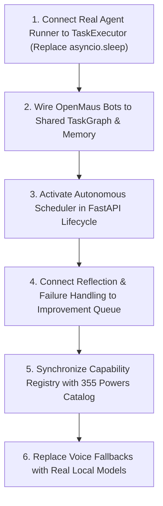

# JARVIS Capability Audit: Executive Summary & Scorecard

**Date:** 2026-11-03  
**Audit Branch:** `audit/capability-audit`  
**Auditor:** Antigravity Autonomous Audit Agent (Strict Evidence-Based Mode)  
**Codebase Root:** `C:\Users\Ganesh Nair\.gemini\antigravity\scratch\Jarvis`  

---

## 1. Honest Scorecard

| System / Subsystem | Evidence Found | Key Implementation File | Audit Status |
| :--- | :--- | :--- | :--- |
| **FastAPI REST API & Entrypoints** | Full FastAPI app with 15 mounted route groups. Starts cleanly. | `jarvis/api/server.py:48` `app/main.py:1` | **REAL** |
| **LangGraph Cognitive Loop** | 8-node state machine (`perceive` → `recall` → `act` → `remember`). | `graph/jarvis_graph.py:196` `graph/nodes.py:1` | **REAL** |
| **Persistent Goal Lifecycle** | SQLAlchemy `GoalModel` in SQLite. Creates and updates status. | `jarvis/db/models/goal.py:17` `jarvis/services/goal_service.py:26` | **REAL** |
| **DAG Task Graph Engine** | Cycle detection (Kahn's), topological sort, priority queue. | `jarvis/core/task_graph.py:85` | **REAL** |
| **7-Layer Memory & SQLite Store** | WAL SQLite store with `memory_nodes` and `LocalMem0Adapter`. | `jarvis/memory/layers.py:46` `jarvis/memory/mem0_client.py:46` | **REAL** |
| **10-Layer Security & Secret Shield**| Outbound prompt sanitization, credential & entropy scanner. | `jarvis/security/ten_layer_shield.py:30` | **REAL** |
| **Browser Playwright Automation** | Headless browser context, DOM sanitizer, screenshot capture. | `jarvis/browser/context_manager.py:34` `jarvis/browser/research_worker.py:44` | **REAL** |
| **Career Automation Engine** | Job scanner, offer analyzer, ATS resume & cover letter parser. | `jarvis/career/service.py:25` `jarvis/career/form_autofill_agent.py:45` | **REAL** |
| **Task Execution Engine** | Graph executor runs; but executes `asyncio.sleep(0.01)` stub. | `jarvis/core/task_executor.py:121` | **PARTIAL** |
| **OpenMausBot / GrokBot** | 5 persona prompts + multi-cloud LLM rotator; zero task loop. | `jarvis/core/openmaus_grok.py:334` `jarvis/api/routes_grok.py:28` | **PARTIAL** |
| **Permission Broker** | HMAC token issuance logic exists; never enforced on tool calls. | `jarvis/core/openmaus_grok.py:191` `graph/nodes.py:300` | **PARTIAL** |
| **Capability Registry** | Static 8-item registry; no sync with 355-power catalog. | `jarvis/capabilities/registry.py:18` | **PARTIAL** |
| **Voice Interaction Pipeline** | Windows SAPI TTS works; wake word & STT are mock fallbacks. | `jarvis/voice/tts.py:42` `jarvis/voice/stt.py:53` | **PARTIAL** |
| **Autonomous Scheduler** | Scheduler class defined; `start()` is NEVER called in startup. | `jarvis/core/scheduler.py:42` | **REPORT-ONLY** |
| **Inter-Agent Handoff** | `handoff_task` returns hardcoded success dict; no real routing. | `jarvis/powers/multiagent_powers.py:119` | **REPORT-ONLY** |
| **Self-Improvement Queue** | In-memory service; zero production failure handlers write to it.| `jarvis/self_improvement/service.py:36`| **REPORT-ONLY** |
| **11 Vendor Repositories** | `repos/` directory does not exist; stubs/wrappers written instead.| `config/powers/master_powers_355.json`| **REPORT-ONLY** |
| **Kokoro-82M Local Neural TTS** | Not present anywhere in codebase; defaults to Windows SAPI. | `jarvis/voice/tts.py:38` | **REPORT-ONLY** |

---

## 2. Top 5 Architectural Risks

1. **Simulated DAG Task Execution (The "Sleeping Agent" Bug):**  
   While `TaskGraph` Kahn's algorithm and topological sort are fully operational and verified, `TaskExecutor.run()` defaults to `_default_agent_execution` (`jarvis/core/task_executor.py:121`), which does `await asyncio.sleep(0.01)` and returns a mock success dictionary. No actual LLM agent or tool executes the subtasks in the DAG.
2. **Stateless OpenMausBot Personas Masquerading as Autonomous Agents:**  
   GrokBot, CodeMaus, ScoutMaus, OpsMaus, and ReflexMaus (`jarvis/core/openmaus_grok.py`) cannot accept task assignments, cannot poll a work queue, and cannot retain memory across turns. They are static system prompt overrides dispatched to cloud LLM APIs.
3. **Dormant Autonomous Scheduler:**  
   The `ProactiveAutonomousScheduler` (`jarvis/core/scheduler.py:42`) is never started during FastAPI startup or CLI execution. JARVIS has zero autonomous background activity unless an external caller hits `POST /scheduler/trigger/{job_id}`.
4. **Synthetic Reflection & Improvement Backlog:**  
   `POST /api/v1/reflections` (`jarvis/api/routes/reflections.py:187`) synthesizes a fake dummy node `t_root` and returns a hardcoded claim of `100% QA compliance`. The `ImprovementService` queue is never written to upon task failure in the executor.
5. **Critical Host Resource Bottleneck (Disk Exhaustion):**  
   The host machine's `C:` drive has only **2.84 GB free space remaining** out of 292 GB. Downloading local LLMs (e.g. Ollama Llama 3 8B ~4.7 GB or Kokoro TTS weights) will fail with `Disk Full` errors until disk space is reclaimed.

---

## 3. Recommended Order of Work

Based on what actually exists in code rather than aspirational reports:

1. **Connect Real Agent Runner to `TaskExecutor`:**  
   In `jarvis/core/task_executor.py`, replace `_default_agent_execution` with a real call to `model_router` or an agent worker that parses `node.tool_requirements`, executes the corresponding `jarvis/powers/*.py` function, and verifies the outcome.
2. **Connect OpenMaus Bots to Memory & Tasks:**  
   Wire `openmaus_harness.chat()` in `jarvis/core/openmaus_grok.py` to `LocalMem0Adapter` so bots recall user history, and allow bots to claim and execute `TaskNode` instances from `GoalService`.
3. **Activate Scheduler in FastAPI Lifecycle:**  
   Add an `@app.on_event("startup")` or `lifespan` handler in `jarvis/api/server.py` that calls `proactive_scheduler.start()`, giving JARVIS true proactive background capability.
4. **Wire Task Failure to `ImprovementService`:**  
   When a node in `TaskExecutor` fails, instantiate an `ImprovementProposal` and persist it to SQLite so self-improvement reflects actual runtime errors.
5. **Dynamic Capability Registry Sync:**  
   Generate the `CapabilityRegistry` dynamically from `config/powers/master_powers_355.json` and power module introspection.
6. **Voice Pipeline Upgrades:**  
   Integrate real local neural weights (or faster-whisper and Kokoro) once host disk space is cleared.

---

## 4. Honest Classification Verdict

### Is JARVIS currently an Agent OS, an Agent Platform, or an Agent-themed Codebase?

> ### **VERDICT: JARVIS is currently an ADVANCED AGENT PLATFORM with Stubs in the Autonomous Loop.**

### Justification:
- **Why NOT an "Agent-themed Codebase":**  
  An agent-themed codebase has only documentation and mock UI prototypes. JARVIS is significantly more substantial: it has **79 fully active, tested modules**, a working **FastAPI REST server with 15 mounted sub-routers**, an active **8-node LangGraph state machine** with SQLite persistence, a **10-layer DLP security suite**, working **Playwright browser research and form autofill**, and a **557-passing test suite**.
- **Why NOT YET an "Agent OS":**  
  A true Agent OS requires an autonomous executive kernel where background agents own tasks, hand work off to each other, self-heal upon failure, and proactively execute without external human stimulus. In JARVIS:
  - Task execution simulates work via `asyncio.sleep(0.01)`.
  - The scheduler never starts automatically.
  - Inter-agent handoff is a mock dict.
  - Multi-bot personas are single-turn chat prompts.
- **Why it IS an "Agent Platform":**  
  The skeletal scaffolding, database models, topological DAG graph, routing layers, security gates, memory vaults, and tool interfaces are already built and architecturally aligned. By replacing the executor stubs with real agent invocation loops, JARVIS can transition into a true Agent OS.
