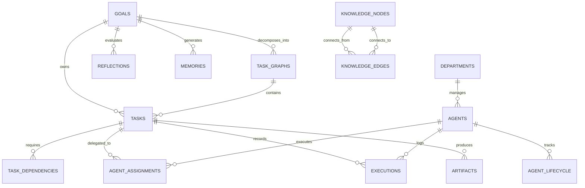

# JARVIS Database Architecture: The Cognitive Hippocampus

## Executive Summary

If the **Task Graph Engine** is the brain cortex of JARVIS, then the **Database is the hippocampus**. Without a persistent, transactional memory substrate, JARVIS would suffer from catastrophic amnesia across restarts, lost execution contexts, and uncoordinated multi-agent race conditions.

JARVIS resolves this through a **Domain-Driven Architecture (DDD)** and a hybrid local-first storage topology:

```
Task Graph Engine (Cortex)
        │
        ▼
   Service Layer (GoalService, TaskService, AgentService, MemoryService, OpportunityService)
        │
        ▼
   Repository Layer (GoalRepo, TaskRepo, DependencyRepo, AgentRepo, AssignmentRepo,
                     ExecutionRepo, MemoryRepo, ReflectionRepo, OpportunityRepo,
                     SchedulerRepo, ArtifactRepo, KnowledgeGraphRepo, AuditRepo)
        │
        ▼
   Database Layer (PostgreSQL / SQLite, Redis Live State, Vector Memory, Knowledge Graph)
        │
        ▼
   Storage Layer (Artifact Vault, MinIO / Local Filesystem)
```

---

## 1. Hybrid Storage Topology

| Subsystem | Technology | Role |
| :--- | :--- | :--- |
| **Operational Brain** | PostgreSQL (Prod) / SQLite (Local-First Dev) | Goals, Task Graphs, Tasks, Dependencies, Departments, Workforce Roster, Tool Telemetry, Audits |
| **Real-Time State** | Redis (with in-memory thread-safe fallback) | High-frequency live agent progress, active tasks, and heartbeats (`agent:{dept}:{name}:status`) |
| **Semantic Memory** | Relational / SQLite + Vector Store | Categorized episodic experiences, user preferences, and solutions |
| **Knowledge Graph** | Relational Graph Nodes/Edges (Phase 1) / Neo4j (Phase 2) | Interconnected entities, technical skills, domain relationships, and BFS shortest-path queries |
| **Artifact Store** | Local Filesystem / MinIO Object Storage | Architecture diagrams, generated code, PDFs, and SHA-256 verified outputs |

---

## 2. Core Relational Schema (16 Tables)

All tables use UUID (`GUID`) primary keys, UTC ISO-8601 timestamps, and cross-platform `UniversalJSON` (PostgreSQL `JSONB`, SQLite `JSON`):



### Table Definitions & Roles:
1. `goals`: Strategic objectives (title, priority, created_by, status, metadata).
2. `task_graphs`: DAG metadata (goal_id, status, version, graph_name).
3. `tasks`: Atomic work nodes (task_key, name, description, department, status, priority, tool_requirements, outputs).
4. `task_dependencies`: DAG directed edges (`task_id` depends on `depends_on_task_id`).
5. `departments`: Organizational business units (`hackathon`, `engineering`, `research`, `operations`, `security`, `career`).
6. `agents`: Specialized AI worker definitions (agent_key, role, model_name, capabilities).
7. `agent_assignments`: Cryptographic records linking tasks to assigned agents.
8. `agent_lifecycle`: **Dynamic workforce manager** logging `created`, `paused`, `resumed`, and `retired` events.
9. `executions`: Comprehensive tool call audit trail (tool_name, inputs, outputs, status, execution_time).
10. `memories`: Episodic intelligence repository indexed by category and semantic content.
11. `reflections`: Post-goal retrospective reports (successes, failures, improvements, opportunities).
12. `opportunities`: Career intelligence engine (type, title, source, score, justification).
13. `artifacts`: Task deliverables with SHA-256 checksums and file locations.
14. `schedules`: Autonomous recurring cron database.
15. `audits`: Immutable operational audit trail.
16. `knowledge_nodes` & `knowledge_edges`: Long-term relational knowledge graph with BFS traversal.

---

## 3. The Unit of Work Pattern (`UnitOfWork`)

Instead of agents directly querying the database or leaking database sessions, all operations occur inside atomic Unit of Work transactions:

```python
with UnitOfWork() as uow:
    goal = uow.goals.create_goal(title="Win AI Hackathon", priority="CRITICAL")
    graph = uow.tasks.create_task_graph(goal_id=goal.id)
    t1 = uow.tasks.create_task(task_graph_id=graph.id, goal_id=goal.id, name="Scout Problem")
    t2 = uow.tasks.create_task(task_graph_id=graph.id, goal_id=goal.id, name="Design MVP")
    uow.dependencies.add_dependency(task_id=t2.id, depends_on_task_id=t1.id)
    uow.commit()  # Single atomic commit with rollback safety
```

### Special DAG Query: `get_unblocked_tasks()`
```python
unblocked_tasks = uow.tasks.get_unblocked_tasks(task_graph_id)
```
Evaluates all pending tasks in the DAG. If 100% of a task's parent dependencies are `COMPLETED`, transitions the task to `READY`; otherwise flags it as `BLOCKED`.

---

## 4. Dynamic Agent Lifecycle Management

To prevent running 100+ idle processes concurrently on consumer hardware (such as an RTX 4050 6GB GPU), JARVIS implements dynamic worker provisioning via `AgentLifecycleModel` and `AgentService`:
- **Spawn on Demand**: Creates worker agents dynamically when a department requires their specific capabilities.
- **Pause & Yield**: Pauses workers during long compute waits to reclaim memory.
- **Retire**: Automatically transitions completed project workers to `RETIRED` while preserving full audit history.

---

## 5. Reactive Domain Event Bus (`EventBus`)

Whenever key operations occur in the database, domain events are published:
- `TaskCreatedEvent`
- `TaskCompletedEvent`
- `GoalCompletedEvent`
- `OpportunityDiscoveredEvent`
- `AgentLifecycleEvent`

Subscribers react asynchronously without coupling core database queries to agent execution logic.
