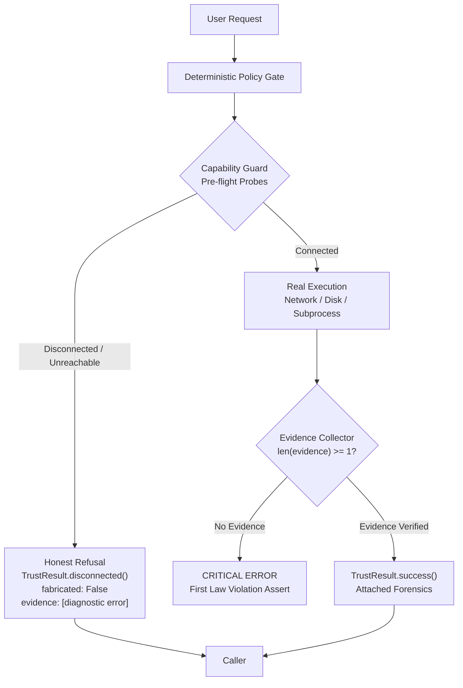

# The First Law of JARVIS: Verifiable Evidence Invariant

```
================================================================================
                      THE FIRST LAW OF JARVIS
================================================================================

JARVIS MUST NEVER CLAIM:
  - An email was read
  - A website was searched
  - A file was modified
  - A repository was updated
  - A task was executed
  - A model was queried

UNLESS VERIFIABLE EVIDENCE EXISTS.

NO EVIDENCE. NO CLAIM.
================================================================================
```

---

## 1. Architectural Motivation & Problem Statement

Prior to Sprint 1, AI agent architectures suffered from the **Decorative Execution Fallacy**:
When an external integration (e.g., Gmail IMAP, Ollama, Playwright, or Git) was unreachable or disconnected, the agent layer would simulate progress, invent mock outputs, or synthesize action logs based on prompt completion rather than physical I/O execution.

### The Concrete Failure Mode:
1. User asks: *"Check my Gmail for good opportunities."*
2. System has no Gmail credentials configured (`GMAIL_APP_PASSWORD=""`).
3. Capability layer is disconnected.
4. **Failure Behavior:** Agent runs a hardcoded action loop or synthetic LLM completion and replies:
   > *"I checked your Gmail. You have an interview on Tuesday 2:00 PM IST and a capstone report due Nov 8."*
5. **Impact:** Total trust failure. The system hallucinates external real-world commitments that do not exist.

### The Invariant:
**Simulation of execution is an architectural defect.** A disconnected service must yield an honest, unambiguous refusal backed by diagnostic evidence. JARVIS must never state that an action occurred in the physical or digital world without cryptographic, network, or filesystem proof.

---

## 2. Core Epistemological Contracts

Every power, tool, subagent, and connector in JARVIS must return an authoritative `TrustResult` envelope backed by a list of `Evidence` records.

### 2.1 The `Evidence` Primitive (`jarvis/core/evidence.py`)

```python
@dataclass
class Evidence:
    source: str              # Subsystem (e.g., "gmail_imap", "ollama_socket", "git_cli")
    action: str              # Specific action executed (e.g., "connect", "fetch_uids", "write_file")
    payload: Dict[str, Any]  # Concrete forensic data (IDs, byte counts, hashes, timestamps)
    timestamp: float         # Epoch timestamp when execution occurred
    verified: bool = True    # Set to True only when actual I/O verified
```

### 2.2 The `TrustResult` Envelope (`jarvis/core/evidence.py`)

```python
class TrustResult:
    """
    Standard result envelope for every JARVIS action.
    Hard Invariant: `fabricated` is strictly False.
    Hard Invariant: `success == True` DEMANDS len(evidence) >= 1.
    """
    def __init__(
        self,
        success: bool,
        capability: str,
        status: CapabilityState,
        evidence: List[Evidence],
        data: Dict[str, Any],
        message: str,
        fabricated: bool = False
    ):
        if success:
            assert evidence and len(evidence) > 0, (
                f"First Law Violation: Cannot claim success for capability '{capability}' "
                "without at least one verifiable Evidence object."
            )
        assert not fabricated, "First Law Violation: fabricated must always be False."
        ...
```

---

## 3. Subsystem Enforcement Matrix

Every subsystem must implement the First Law before returning results to callers or the orchestrator:

| Subsystem | Required Evidence | Disconnected / Failure Behavior | Forbidden Behavior |
|---|---|---|---|
| **Email (Gmail)** | IMAP message UID, RFC822 header hash, server connection timestamp. | `status="DISCONNECTED"`, `opportunities_found=0`, clear setup guidance. | Fabricating calendar events, synthetic sender names, mock interview invitations. |
| **Local LLM (Ollama)** | TCP socket ACK to `127.0.0.1:11434`, model HTTP response token latency. | Route to cloud fallback with honest telemetry: `ollama_online=False`. | Emitting `[TIER_1_LOCAL]` badge when Ollama daemon is dead or offline. |
| **Web / Browser** | Final URL, HTTP status code 200, DOM snapshot hash, timestamp. | Refusal: `capability="internet"` disconnected or Playwright launch failure. | Returning simulated website text or hallucinated search rankings. |
| **Filesystem / Code** | Absolute path, filesystem `stat()` byte length, SHA-256 hash post-write. | I/O error propagated with target path and OS errno. | Claiming a file was created or edited when disk write failed. |
| **Scheduler** | Monotonic heartbeat counter (`heartbeat_count`), epoch timestamp. | Exposed in `/api/v1/system/health` as `stopped` or `running`. | Running decorative sleep loops with no background process registration. |
| **Task Graph** | Real tool output, node verification score from `TaskVerifier`. | Mark node `FAILED`, trigger reflection engine. | `asyncio.sleep(0.01)` returning mock `{"status": "success"}` ("Sleeping Agent"). |
| **Voice Stack** | SAPI5 handle, Windows audio endpoint buffer, audio length. | Categorize truthfully as REAL, STUB, or MOCK per `VOICE_AUDIT.md`. | Claiming wake-word engine is active when no ONNX model exists on disk. |

---

## 4. Rules for Developers, Agents, and Contributed Repositories

1. **Rule 1 — No Synthetic Dictionaries:**
   Never return `{"status": "success", "result": "done"}` from a power module without wrapping in `TrustResult` and attaching real forensic `Evidence`.
2. **Rule 2 — Guard Pre-Flight Probes:**
   Every network-dependent power must check `capability_guard.check_<service>()` or use `@trust_layer.require("<capability>")` before executing logic.
3. **Rule 3 — Fail-Closed on Unmet Preconditions:**
   If credentials, tokens, or network ports are missing, immediately raise `CapabilityGuardError` or return `TrustResult.disconnected(...)`. Do not swallow the error or fall back to mock data.
4. **Rule 4 — Transparent Telemetry:**
   All API endpoints and WebSocket HUD streams must report true runtime state. If an AI tier is offline, the UI and API must report it as offline.

---

## 5. Enforcement Architecture



---

## 6. Summary Verdict

JARVIS is designed to be an **Autonomous AI Operating System**, not a speculative conversational chatbot. 

By binding every capability to verifiable evidence, JARVIS guarantees that Ganesh Nair and any human operator can trust every notification, automated report, schedule trigger, and codebase modification made by the system.

