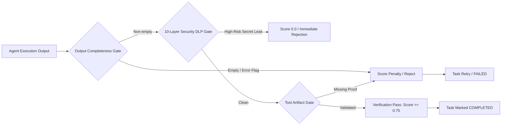

# JARVIS Task Graph Engine (DAG Architecture V1)

## Executive Summary

The **Task Graph Engine** is the central cognitive nervous system of JARVIS. Conventional AI assistant paradigms suffer from an architectural limitation: they attempt single-pass generation or unstructured loops:

```
[Naive Approach]
User Goal ────► Monolithic Agent ────► Direct Result (High Error / Hallucination Rate)
```

In contrast, JARVIS organizes all complex multi-step intentions into a **Hierarchical Directed Acyclic Graph (DAG)** governed by organizational departments, strict quality gates, and episodic memory persistence:

```
[JARVIS Cognitive Architecture]
User Goal
   │
   ▼
Goal Graph
   │
   ▼
Task Graph (DAG)
   │
   ▼
Departments (Hackathon, Engineering, Research, Operations, Security, Career)
   │
   ▼
Worker Agents (Assigned via Central CEO Router)
   │
   ▼
Tools (Model Context Protocol Substrate & Native Powers)
   │
   ▼
Verification Gates (Completeness + 10-Layer Security DLP + Reviewer Scoring)
   │
   ▼
Episodic Memory (SQLite Graph + Vector Indexing)
   │
   ▼
Post-Goal Reflection (Continuous Learning & Architectural Retrospective)
```

This architecture enables **100+ specialized autonomous agents** to collaborate concurrently without race conditions, token context saturation, or state corruption.

---

## 1. Task Graph Data Model (Schema V1)

All elements in the system inherit from validated Pydantic models in `jarvis.core.task_graph`:

### 1.1 Task Status & Priority Enums
```python
class TaskStatus(str, Enum):
    PENDING = "pending"
    READY = "ready"
    RUNNING = "running"
    BLOCKED = "blocked"
    COMPLETED = "completed"
    FAILED = "failed"
    CANCELLED = "cancelled"

class Priority(str, Enum):
    CRITICAL = "critical"
    HIGH = "high"
    MEDIUM = "medium"
    LOW = "low"
```

### 1.2 Task Node Schema
```python
class TaskNode(BaseModel):
    task_id: str
    name: str
    description: str
    department: str
    assigned_agent: Optional[str] = None
    priority: Priority = Priority.MEDIUM
    status: TaskStatus = TaskStatus.PENDING
    parent_goal: str
    dependencies: List[str] = []
    tool_requirements: List[str] = []
    outputs: Dict[str, Any] = {}
    metadata: Dict[str, Any] = {}
    retry_count: int = 0
    max_retries: int = 3
```

### 1.3 Task Graph Topology Schema
```python
class TaskGraph(BaseModel):
    goal_id: str
    nodes: Dict[str, TaskNode]
    edges: Dict[str, List[str]]  # source_task -> [dependent_tasks]
```

---

## 2. Graph Algorithms & Parallelism

### 2.1 Cycle Detection (Kahn's Algorithm)
Before execution commences, `TaskGraph.is_cyclic()` evaluates the in-degree of all nodes:
$$\text{in-degree}(v) = |\{u \in V \mid (u, v) \in E\}|$$
If the number of processed nodes does not match the total node count $|V|$, a cycle exists and execution is immediately aborted with a explicit validation error, preventing infinite agent execution loops.

### 2.2 Topological Sort
`TaskGraph.topological_sort()` produces an execution sequence such that for every directed edge $(u, v)$, task $u$ executes before task $v$.

### 2.3 Parallel Waves (Execution Layers)
`TaskGraph.get_parallel_layers()` partitions the graph into discrete temporal waves:
- **Wave 0**: Nodes with in-degree 0 (e.g., initial research queries, market scans, repo clones). All run in parallel.
- **Wave $k+1$**: Nodes whose dependencies are entirely satisfied within Waves $0 \dots k$.

---

## 3. Concurrency & Scheduling (`TaskScheduler`)

The `TaskScheduler` (`jarvis/core/task_scheduler.py`) manages dynamic state progression:
1. **Concurrency Throttling**: Limits active simultaneous tasks (e.g. `max_concurrency = 5`) to preserve local GPU VRAM (RTX 4050 6GB) and cloud rate-limits.
2. **Priority Dispatch**: Ready tasks are sorted by priority (`CRITICAL` > `HIGH` > `MEDIUM` > `LOW`).
3. **Downstream Unblocking**: When task $u$ transitions to `COMPLETED`, its downstream children in `edges[u]` re-evaluate their dependency constraints. If all parent tasks are complete, the child transitions from `PENDING`/`BLOCKED` to `READY`.
4. **Cascaded Failure & Retries**: If a task fails, it retries up to `max_retries`. If retries are exhausted, the scheduler marks the node `FAILED` and cascades `CANCELLED` status to all dependent descendants.

---

## 4. Multi-Stage Verification Quality Gates (`TaskVerifier`)

No task node transitions to `COMPLETED` directly upon agent output. Outputs must be approved by `TaskVerifier.verify_task()`:



---

## 5. Episodic Memory & Post-Goal Reflection

1. **Episodic Memory Integration (`TaskMemoryWriter`)**:
   Every successfully completed task automatically formats a structured `MemoryEvent` persisted to both `data/task_memory_events.json` and the permanent SQLite memory graph (`db_store.save_memory`).
2. **Continuous Reflection (`TaskReflectionEngine`)**:
   When a graph finishes, the reflection engine performs post-mortem analysis:
   - Identifies bottlenecks and failed retries.
   - Extracts actionable architectural opportunities.
   - Persists structured `ReflectionRecord` to `data/reflections.json`.
