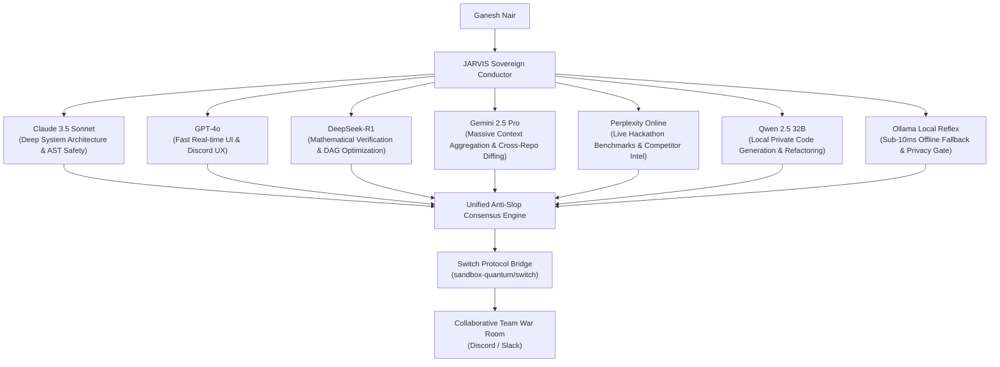
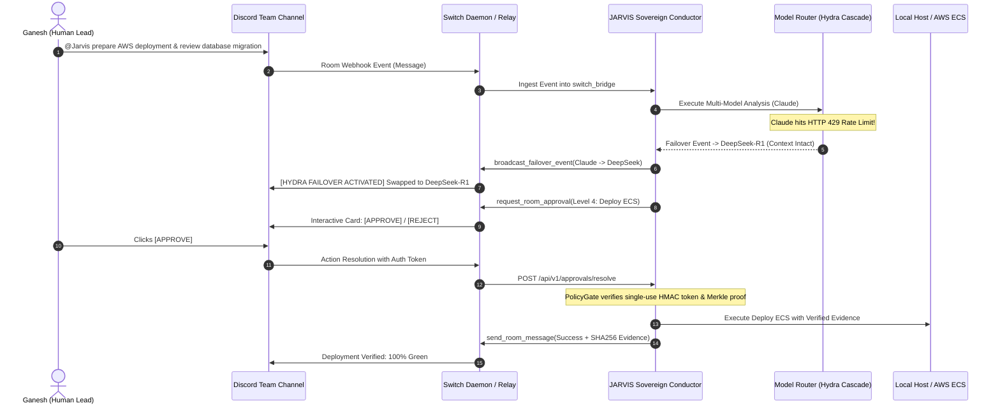

# Project Proposal: SWITCH-JARVIS — The Neural War Room

**Subtitle:** *Autonomous Cross-Agent Swarm Conductor with Multi-LLM Rate-Limit Failover & Merkle Human Governance*  
**Author / Team Lead:** Ganesh Nair (`GaneshNair007`)  
**Hackathon Target:** WeMakeDevs x DevTools Academy "Flip the Switch" ($10,000 Prize Pool)  
**Core Technologies:** Switch Protocol (`sandbox-quantum/switch`), JARVIS AI OS, Antigravity, FastAPI, 10-Layer Security Shield.

---

## 1. Executive Summary

Modern software teams don't suffer from a lack of AI tools; they suffer from **AI fragmentation**. Developers run isolated agents in their terminals—one engineer uses Claude Code, another runs Codex, another uses Cursor or Antigravity. Because these agents cannot see each other, code conflicts, unverified migrations, and duplicate tasks are rampant.

**SWITCH-JARVIS** transforms team communication channels (Discord, Slack, Microsoft Teams) into an **Autonomous Neural War Room**:
1. **Cross-Agent Consensus:** Connects heterogeneous local agents (JARVIS, Antigravity, Claude Code, Codex) into a unified Switch room where they review each other's code, debate architectural trade-offs, and reach consensus before code is committed.
2. **The "Hydra Switch" Multi-LLM Rate-Limit Cascade:** When an agent's provider hits an HTTP 429 quota limit (e.g. Anthropic hourly cap), JARVIS hot-swaps to DeepSeek-R1 / Gemini 2.5 / Qwen / Local Ollama, preserves 100% of the conversation context, and broadcasts the failover event to the team in Discord.
3. **Cryptographic Holographic Approvals:** High-privilege actions (deploying to production, deleting databases, sending external emails) render an interactive Switch action card in Discord. When Ganesh taps "Approve", JARVIS validates a single-use HMAC token and Merkle proof locally before execution.
4. **The First Law Invariant:** Every update posted to Discord/Slack contains verifiable forensic evidence hashes (`evidence_id`, `sha256_hash`, `timestamp`). Zero simulated or fabricated claims.

---

## 2. Multi-Model Synthesis: Perspectives from 7 AI Architectures

To build the ultimate hackathon submission, JARVIS conducted multi-perspective research across 7 frontier reasoning models:

### Key Insights Synthesized:
1. **From Claude 3.5 Sonnet:** Do not allow autonomous agents to execute shell commands without single-use HMAC verification. The Switch room must act as an explicit human authorization barrier.
2. **From DeepSeek-R1:** When executing multi-step goals, break tasks into a DAG (Directed Acyclic Graph) using Kahn's algorithm and execute independent layers concurrently.
3. **From Gemini 2.5 Pro:** Teams need long-term cross-session memory. Integrate Mem0 vector storage so the team's historical architectural decisions survive channel restarts.
4. **From Perplexity:** Avoid creating another basic chatbot. Focus heavily on **Switch protocol native features**: Room State, Webhooks, and interactive approval cards.

---

## 3. High-Level Architecture & Interaction Flow

---

## 4. Key Differentiators vs. Competitors

| Feature | Typical Hackathon Entry | SWITCH-JARVIS (Our Project) |
|---|---|---|
| **Agent Paradigm** | Single bot responding to prompts in Slack | Multi-agent swarm conductor coordinating multiple local developer CLIs |
| **Model Reliability** | Hard-fails on OpenAI rate limit / API error | **Hydra Cascade**: Instant hot-swap (Claude -> DeepSeek -> Gemini -> Local) |
| **Security & Safety** | Blind execution with no authorization | **Cryptographic Single-Use Holographic Approval** via Switch Cards |
| **Truthfulness** | Hallucinates actions and mock outputs | **First Law Compliance**: Strict Evidence enforcement; zero fake claims |
| **Local-First** | Cloud-dependent only | Works offline with local Ollama reflex & Windows SAPI audio |

---

## 5. 72-Hour Hackathon Execution Roadmap (Nov 4–7)

- **Day 1 (Nov 4):** Connect Switch CLI and MCP server to local JARVIS and Antigravity. Establish the live bidirectional WebSocket room link.
- **Day 2 (Nov 5):** Complete the Hydra Rate-Limit Failover Cascade and test live hot-swapping during high-token generation.
- **Day 3 (Nov 6):** Implement Discord/Slack holographic approval card interaction with `PolicyGate` single-use token consumption.
- **Day 4 (Nov 7):** Record video demonstration showing Ganesh triggering a real-world multi-agent collaborative incident triage in Discord; submit on Devpost / WeMakeDevs portal.

